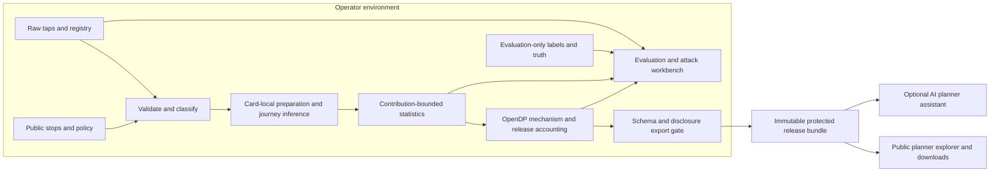

# RouteSafe build plan

> **Audience update from the project lead, 7 November 2026:** judging also includes hackathon participants, most of whom are beginners. Participants judge from videos: each sees two videos, chooses the better one, and repeats this 20 times. This is lead-provided event context, not a claim about scoring weights or video duration. The product and video must communicate their purpose immediately, with an obvious visual hook and minimal unnecessary text.
>
> **Design consequence:** open on the actual city map and a visible useful action. Show one causal journey: data → protected statistics → map → a saved planning choice. Give each owner step one goal, one visible output and one primary action. Use short labels and visual changes; move method detail into disclosure panels. Keep the synthetic-data label, uncertainty and measured failures readable. Do not substitute slogans, invented impact or a prettier dataset for evidence.

Prepared 6 November 2026. **Planning only: no product has been implemented or experimentally validated by this document.** Read this first, then [the interface contract](planning/INTERFACES.md) and [the coordination guide and launch prompts](planning/COORDINATION.md). Together these are the build brief for GPT-6 Astra and Opus 5.5 at maximum effort. The allocation is practical, not a claim about model superiority.

## 1. Recommendation and intended outcome

Build **RouteSafe: useful transport statistics without publishing passenger histories**.

The operator keeps boarding records inside its own environment. RouteSafe identifies sensitive fields, constructs a small set of planning statistics, limits each travel card's contribution, and releases differentially private counts. An external planner receives an interactive map, demand charts, downloadable aggregate tables, and a readable explanation of how the release was made. The planner's browser cannot query the original records.

The demonstration has one clear causal story:

1. A few sightings isolate a card's travel history in a pseudonymised row-level release.
2. The operator uses RouteSafe to publish statistics instead of histories.
3. The planner can still identify promising corridors for a service review.
4. We show how much that decision and the underlying statistics changed, including uncertainty and limitations.

The distinctive work is the connection between the attack, an explainable field scanner, a correctly bounded release, a useful decision, and evidence a judge can inspect. Differential privacy and maps are established techniques; do not claim their invention. Avoid a general-purpose privacy dashboard with an impressive-looking but unexplained score.

### Accepted scanner integration

The team's [combined proposal](COMBINED_IDEA.md) is adopted with the following scope decisions. These decisions govern where that proposal differs from this plan; its original text remains a record of the suggestion.

* **Reuse the local rule-based scanner as RouteSafe's first operator step.** Vaishnav/Opus owns its code under `petpilot/`, its field inventory and operator presentation. Astra owns validation of the handoff, the approved transformation policy and independent evaluation. Do not build a competing generic detector in `pipeline/`.
* **Make selection visible and purpose-specific.** Each field's detected role and reason connects to the public-planning purpose and a concrete handling decision: omit, internal grouping only, public-reference mapping, time binning, or bounded aggregation followed by DP. Classification informs the explanation; it does not authorise a field to leave the operator.
* **Ship MOB-S1 aggregate publication, not the proposed MOB-S2 row export.** Weekly rotating pseudonyms and rounded times do not establish that travel histories are safe to share. A consultancy request may show “row-level sharing unsupported in this prototype” and offer aggregate statistics. Do not build a second transformation engine or a misleading “safe for consultants” switch. A second release mode requires a separate threat model, access controls, evaluation and scope decision after the core is complete.
* **Keep the mystery-file scene optional.** It can demonstrate scanner portability or a synthetic hashed-identifier risk, but must not replace utility evidence or exceed the video limit. It is already inspected by the teammate, so it is no longer an unseen test for this team's scanner. Do not say it “understands any dataset.”
* **The scanner is not AI.** Preserve the bounded planner assistant as the primary AI feature. Optional AI classification hints remain advisory and local or strictly metadata-only; a short category code may still encode salary, union membership or health information and is not automatically safe to send to a cloud model.

The proposal reports macro-F1 0.87 and sensitive-column recall 92%, versus supplied baseline figures of 0.65 and 73%, and 2,111/2,818 synthetic identifier-hash matches. These are **teammate-reported development results, not independently reproduced results**. The proposal says labels were visible during rule development and that some sensitive attributes remain missed. Retrieve code, commands and results before adopting any number. Report observed generalisation performance when measured; do not assume its magnitude in advance. A matched hash illustrates recoverability with a specified candidate source, not arbitrary inversion of SHA-256.

**Code availability update:** the teammate subsequently pushed `petpilot/` in commit `4cd1374`. Its README, CLI and relevant classification logic have been inspected for this integration; its accuracy has not been rerun. Use the existing CLI and adapt its output rather than rewriting it. E1S must specifically challenge two observed heuristics: treating a table as non-sensitive when no person signal is detected, and treating a hash as non-sensitive when no link is found. Neither absence is evidence that hidden sensitive attributes are safe. The hashed-column detector samples candidate matches; the reported full-file recovery count needs its own reproducible evaluation command.

**Recommended first architecture:** a Python private publishing CLI/workbench, a versioned static release bundle, and a TypeScript public explorer. Use OpenDP for the noise mechanism after a small compatibility experiment. No live private-data query API is needed. A release ledger prevents accidental repeated spending. This is simpler to audit and more reliable to demonstrate than a distributed cryptographic system.

**One-minute technical explanation:** “Removing names leaves recognisable journeys. We keep the journey records with the operator and publish only a fixed set of statistics. First, we cap how much any one card can influence them. Then an established differential privacy mechanism adds noise calibrated to that cap. The planner can explore the published statistics repeatedly without contacting the private database. We measure both what was lost and whether the same planning priorities remain. Our guarantee covers a card's records in the stated period; multiple cards belonging to one person are an explicit limitation.”

### Product definition

| Item | Decision |
|---|---|
| Primary beneficiary | External municipal or regional transport planner reviewing service demand across the operator's area |
| Data owner and buyer hypothesis | Transport operator or regional transport authority that needs to publish useful statistics repeatedly without distributing individual histories |
| Actual decision | Choose three weekday morning inter-area corridors for further service investigation; inspect line/hour demand and period trends to inform that review |
| Inputs | Supplied synthetic Aura Transit taps and public stop reference data; card registry inspected for classification and identity limitations, not required as an analytical join |
| Output | Protected inferred OD counts, protected recorded boarding counts, rankings, uncertainty, aggregate CSV/JSON, and release documentation |
| Value proposition | A repeatable publishing workflow with an understandable disclosure boundary, measurable information loss, reusable outputs, and an audit trail |
| Commercial hypothesis | Reduces repeated manual disclosure review and the need for bespoke access agreements for each aggregate planning request; validate with an operator after the event |
| Explicitly unsupported | Optimal routes, vehicle capacity, overcrowding, costs, carbon savings, unmet demand, passenger-level tracking, actual home/work addresses, or proven real-world ridership forecasts |

“Three corridors” is a **planning assumption**, not an optimisation result. No timetable, capacity, budget, journey destination observations, or unmet-demand labels are supplied. A corridor is an origin–destination area pair, not an actual bus path. Arcs must not imply road geometry.

## 2. Requirements and evidence hierarchy

### Official requirements

The local [challenge PDF](TRUSTED_SinceAI2026_FINAL/Challenge_TRUSTED_PETs_Transformer_EN%20%281%29%20%281%29.pdf) and [detailed brief](TRUSTED_SinceAI2026_FINAL/TrustED_PETs_Transformer_Challenge_Brief_FINAL_REVIEW%20%281%29.docx) require a working PET prototype, suitable data, measurable privacy/usefulness trade-offs, and the five demonstration elements below. The brief uses Since AI's existing technical implementation, innovation, impact, and presentation criteria; it introduces **no new weighted rubric**. AI is optional in the challenge brief and should add value.

The published event rules set **Sunday 8 November 2026, 10:00 Finland time (EET; 08:00 UTC)** as the submission deadline. They require a complete Since AI submission and a corresponding Devpost submission. The official operational schedule can supersede published timing; the human lead must check the authenticated event page or onsite announcement at kickoff. Use the earlier confirmed deadline if there is a conflict. [Published event rules](https://sinceai2026.devpost.com/rules)

The public event submission page requires a working prototype or testing route, a public or judge-accessible repository, a **public demo video of at most two minutes**, project and architecture descriptions, disclosure of pre-existing assets and work completed during the event, responsible implementation, and next steps. It also asks for meaningful AI/ML, whereas the challenge brief permits optional AI and the rules use broader technology wording. Plan one useful AI-assisted interaction and confirm any ambiguity with event support; do not assume coding with AI alone satisfies the product requirement. [Event submission requirements](https://sinceai2026.devpost.com/)

| Required element | What the product demonstrates | Evidence and acceptance | Initial owner |
|---|---|---|---|
| R1 Identify data types | Local scanner distinguishes direct identifiers, persistent keys, spatiotemporal quasi-identifiers, sensitive attributes, categories, measurements, and public reference data | Field inventory with reasons and unknowns; field catalog used for evaluation only; scanner results independently reproduced | Vaishnav/Opus; Astra evaluates |
| R2 Explain PET choices | Omission of unnecessary attributes, temporal/spatial aggregation, bounded contributions, DP counts, safe post-processing | Per-field and per-statistic rationale; privacy unit, adjacency, caps, budget, library/version, assumptions | Astra; Opus reviews explanation |
| R3 Show protected output | Planner map, aggregate table, release manifest, downloadable bundle | Actual released values; no row histories or identifiers; download matches what powers UI | Opus; Astra validates |
| R4 Compare usefulness | Raw-derived reference, prepared/clipped counts, protected counts and planning shortlist | Numerical errors, contribution-loss analysis, repeat-run distribution, decision retention, supplied baseline comparison | Astra; Opus presents |
| R5 Explain sharing scenario | Operator publishes aggregate demand statistics to external planners/public | Named recipient, purpose, period, appropriate use, unavailable analyses and access boundary visible | Opus; Astra reviews |

The intended package scenario is **MOB-S1**, with MOB-U1, MOB-U2 and MOB-U3. Addressing all nine data domains, every utility task, or the unseen dataset is not required by the supplied challenge brief. The toolkit's composite is a self-assessment aid, **not an official judging score**. Unsupported metrics are “not evaluated/not applicable,” never implicitly perfect.

### Strategic preferences from the team

TrustED is not onsite and the Since AI panel judges the entry. Explain the essential mechanism quickly, then make technical evidence easy to inspect. The panel may contain knowledgeable privacy engineers. Prioritise a useful product, elegant engineering, polished interactions, an immediately understandable reveal, and reliable delivery. The supplied package was produced by Since AI, inspired by the European project; it is not a TrustED production deliverable.

The European project's emphasis on trustworthy exchange and privacy-preserving technology supports this direction; it does not require reproducing its identity or federated-learning infrastructure. There is no mandatory TrustED account or API in the brief. [TrustED project](https://trustedproject.eu/)

### Assumptions and open checks

The team has selected [Chintufp/Since-AI-hackathon---WAWS](https://github.com/Chintufp/Since-AI-hackathon---WAWS) as the shared public repository and authorised uploading this plan and the complete supplied folder. Current-machine GitHub access and push permission are verified; the second builder's access remains to be checked. Local `git` and `gh` are available. Large materials require Git LFS. Deployment/video hosting and a permitted model API or local model remain build assumptions. Resolve these in E0 without delaying local work. Preserve the teammate's existing README as background; this plan governs the specific RouteSafe build.

## 3. What the supplied data supports

The fictional Aura Transit dataset covers **6 October–2 November 2025**, not the hackathon dates. All riders and trips are synthetic; stop placements are synthetic on real postcode geography. Do not present findings as facts about real Turku transport. [Mobility data documentation](TRUSTED_SinceAI2026_FINAL/TRUSTED_PETS_PROVING_GROUND_2026/data/mobility/README.md), [limitations](TRUSTED_SinceAI2026_FINAL/TRUSTED_PETS_PROVING_GROUND_2026/docs/LIMITATIONS.md)

| Table | Supplied rows | Role in RouteSafe |
|---|---:|---|
| taps | 942,781 | Recorded boarding events: card, time, stop, line, vehicle, fare product, amount; no tap-off |
| cards | 22,619 | Registry with persistent card identifiers and, for some cards, names/contact details and demographics; classification and identity-risk explanation only |
| stops | 602 | Public reference geography, areas and line metadata; validate unique stop keys before joining |
| bike_trips | 57,831 | Separate mode with recorded start/end fields; reserve as a fallback or later extension, not essential bus evidence |
| bike_stations | 75 | Public bike reference data; unused in core bus product |

Inspection of the stop reference finds **21 areas, 54 district labels and six municipalities**. Start with the 21 documented areas and five supplied hour bands. A complete OD domain has 21 × 21 × 5 = 2,205 cells. Coarsening to six municipalities is a purposeful fallback, not an excuse to fabricate precise district demand.

### Keep three kinds of information visibly separate

**Recorded:** boarding time, stop, line, fare fields and the existence of a card. Boardings are not unique people, complete journeys or occupied seats. The registry is not an authoritative person identity service. Multiple cards may belong to one person.

**Inferred:** trip chains and destinations. The supplied utility code removes marked double taps, restricts to weekdays, drops unparseable time/area, sorts within card/day, keeps boardings separated from the preceding boarding by more than 60 minutes, assigns the next retained origin as destination, and closes the last journey to the day's first origin. That can create artificial return legs and single-event self-loops. It is a benchmark heuristic, not destination truth. The production inference policy must be explicit, card-local and versioned.

**Illustrative:** a planner prioritising three corridors, a fictional passenger used in a teaching example, any service-improvement narrative, and any additional data generated by the team. Do not infer demographics, actual homes or workplaces from a route and present them as observed.

### Permitted additional synthetic data

Use a small generated fixture with known journeys and identities to test transfers, repeated identifiers, missing stops, rare routes, duplicate taps, one-person/multiple-card cases and adversarial sightings. Keep a deterministic generator and its parameters. It should be possible to prove expected results by inspection.

A larger stress-test dataset is also allowed, but report its results separately from the supplied benchmark. Never increase density, simplify patterns or choose an unusually favourable example and then imply those results came from Aura Transit. A synthetic teaching scene can make the attack comprehensible; the actual measured singling-out rate must come from the reported evaluation cohort.

## 4. Technical architecture and trust boundary

There are two runnable surfaces with separate entrypoints and build outputs:

* **Private operator workbench:** input validation, inventory, policy explanation, release generation, budget status, attack experiment and before/after evaluation. A CLI plus a local report is sufficient initially; avoid building a full authentication/admin platform.
* **Public recipient explorer:** reads allowlisted protected artifacts and public geometry only. It has no credentials, filesystem mount, backend route, upload endpoint, hidden debug endpoint or bundled module that can access raw records. A UI tab or feature flag is not a security boundary.

A local demonstration can switch between these surfaces. Mark the switch “Operator view” and “Planner's shared view.” A public demo can link a recording of the private experiment; it must not ship the original dataset to reproduce that experiment in the browser.

### Release pipeline

1. **Validate:** strict required columns and types, timestamps, nonempty card IDs, unique reference keys, valid stop joins, finite coordinates, permitted date range and category domain. Preserve source counts and rejection reasons in the private report. Reject ambiguous schemas, many-to-many stop joins, and unrecognised policy revisions. Handle missing IDs explicitly; do not collapse all missing cards into one person or treat each as a fresh person.
2. **Classify:** consume the local `petpilot/` scanner's versioned field inventory, with pattern/schema reasons and explicit unknowns. Use the supplied field catalog as evaluation labels, not a runtime oracle disguised as detection. Known mobility schema can be an explicitly declared supported adapter. Unknown columns are excluded until classified; an LLM suggestion cannot automatically permit publication. The publisher validates required analytical fields independently and exports only the approved aggregate schema, even if the scanner mistakenly labels a sensitive field non-sensitive. See the private scanner contract in `planning/INTERFACES.md`.
3. **Minimise:** core analysis does not need names, birth dates, emails, phones, card type, exact fares or vehicle identifiers. Do not load/join the full registry merely to count boardings. Public stop geography is not private passenger geography.
4. **Prepare:** resolve timestamps in the documented local-time convention; report the 26 October DST ambiguity rather than guessing precise elapsed journeys across repeated clock times. Apply deterministic duplicate and transfer rules within each card. Do not use population-derived “home” locations. Preserve a benchmark-compatible inference path and compare an improved path if tested.
5. **Aggregate with bounded contributions:** build fixed-domain statistics. Bound each card across the entire stated release period and each measurement family. Apply the cap to the final count-contributing units after inference, so the sensitivity proof concerns the actual published statistic.
6. **Protect:** reserve privacy budget, apply an established mechanism, construct uncertainty metadata, and carry out only permitted post-processing. Export nothing until the artifact gate passes.
7. **Publish once:** immutable release ID, manifest, counts, definitions, privacy parameters and artifact checksums. Reusing that artifact is safe post-processing; generating a fresh release is a new privacy event.

### Selected transformations

| Data type | Handling | Reason |
|---|---|---|
| Names, contact details, birth data | Omit from analytical pipeline and all released artifacts | Unnecessary for the planning purpose |
| Card and event identifiers | Use internally for grouping/validation; never release | A pseudonym still connects a history |
| Exact timestamps and stops | Internally map to fixed time bins and public areas | Match the planning question and reduce output dimensionality; binning alone is not a formal guarantee |
| Fare/card categories and amounts | Exclude core public output | No demonstrated need; categories can imply sensitive traits |
| Inferred journeys | Aggregate, contribution-limit, then privatise | Useful relationships without individual chains |
| Aggregate counts | DP measurement plus uncertainty and release accounting | Limits a bounded card's influence on the published result |
| Public geography | Reuse with attribution and source labels | Makes aggregate results interpretable without inventing precise paths |

## 5. Privacy model and release policy

### Guarantee to aim for

The default protected unit is **one travel card's entire set of records during 6 October–2 November 2025**. Neighbouring datasets differ by adding or removing all records for one card. This is a card-level, period-bounded central-DP model: the operator is trusted to hold raw data and execute the approved publisher. It does not protect against an operator compromise or prove real-person anonymity.

For family f, produce a fixed-length count vector q_f. Each card contributes at most C_f total counts across that vector, not C_f per cell. Then adding/removing one card changes its L1 norm by at most C_f. An appropriate Laplace-family mechanism calibrated to C_f / epsilon_f provides the intended pure-DP guarantee for that family; verify the selected OpenDP measurement's privacy map and numerical domain. Across families and subsequent releases involving the same protected population, conservatively compose epsilon by addition. For replacement adjacency the bound can be 2C_f; do not silently switch definitions.

OpenDP can verify the noise measurement's declared distance-to-budget relationship. It does **not** automatically prove that custom journey code and joins respect the declared distance. Document that proof: preprocessing is card-local, public reference tables are fixed, each final contribution is bounded, every released family is accounted, and no data-dependent output bypasses protection. Cross-review plus adversarial/property tests support implementation correctness; tests alone are not a mathematical proof.

### Candidate measurement families

| Family | Meaning | Public domain | Initial cap candidates |
|---|---|---|---|
| OD | Weekday inferred journey count, area × area × hour band, whole period | 21 × 21 × five documented bands; includes zero cells and self-pairs | 16, 32, 64 inferred journeys/card/period |
| Line-hour | Weekday boarding counts excluding marked double taps | Line roster from public reference policy × 24 hours | 32, 64, 128 boardings/card/period |
| Daily | Recorded tap events per date, matching the toolkit definition | All 28 calendar dates, including weekends | 32, 64, 128 tap events/card/period |

These are **experimental candidates**, not approved privacy policy. Start with total epsilon in {0.5, 1, 2}, delta 0 for the proposed mechanism, and compare a simple budget split such as 0.6 OD / 0.3 line-hour / 0.1 daily. E3 must select and justify the final policy. Do not quietly raise epsilon to rescue a map. A value of epsilon is not a universal “safe/unsafe” score.

Use a reproducible, card-local rule to choose contributions when a cap is exceeded. A stable hash-based selection over canonical within-card events is preferable to always keeping the first days; test its temporal bias. This sampling is for bounding, not claimed privacy amplification. Fix the selection procedure independently of the evaluated outcome. Do not seed selection from a whole-dataset hash: removing one card must not change which contributions are retained for other cards. A card-level DP proof remains necessary even if per-day limits are also used.

**Counting definitions matter:** MOB-U1 is weekday inferred journeys; MOB-U2 is weekday boardings excluding marked double taps; MOB-U3's reference code counts daily tap events, including double taps. Preserve these definitions for benchmark parity. A cleaner product metric may be added with a different name and a separate comparison. Never relabel all three as “passengers.”

### Multiple identifiers and time periods

The supplied production fields do not establish a reliable person ID. Do not deduplicate on household contact details or use hidden `person_id` truth to improve the real pipeline. Evaluate the multiple-card issue using truth only in the evaluation environment. For a person with m cards, a conservative group-privacy bound scales to m × epsilon; without a defensible bound on m, no fixed person-level guarantee follows.

A real deployment could use an operator's authorised, trustworthy account-to-card mapping and cap at that account/person unit. This is a future integration, not a capability of this prototype. Report shared cards and replacement cards as additional identity semantics to resolve.

Different monthly windows are not automatically disjoint people. Maintain a cumulative account of releases for overlapping possible participants; do not reset the privacy budget at midnight, on restart, by changing filenames or by rotating pseudonyms. A genuine disjoint-person argument requires evidence not currently available.

### Repeated queries, exports and release accounting

The public product only filters, sums, sorts or explains an already published artifact. An export must contain the same underlying released values, never freshly re-noised values. The public assistant cannot request new private computations.

The private publisher uses a single-writer transactional ledger, initially SQLite, owned by the publisher deployment. It records policy/version, input snapshot identity privately, population/period scope, release ID, family budgets, reserved/spent budget, timestamps and artifact hash. A repeated identical publish request returns the existing committed artifact. Reserve budget before drawing noise; conservatively treat a crash after a possible draw/export as spent until reviewed. Concurrent publish attempts must serialize. Retrying cannot produce a second sample under the same receipt. A checksum proves artifact integrity, not truthful execution or independent certification.

On real data, experimental releases, analyst feedback, diagnostics, model selection or a “passed utility” flag derived from private statistics may themselves leak information. Keep them inside the authorised boundary or explicitly account for their release. Our public before/after evidence is permitted because the evaluation dataset is fully synthetic. Do not describe exact raw comparisons as a free feature for a real public release.

### Domain selection and uncertainty

Use a fixed public area/line/time domain, not “only groups that exist in the private records.” Missing public line IDs go to a predefined unknown bucket or fail validation. Zero-count cells must receive the mechanism too. Suppress or flag detail based on protected values and public rules, never an unprotected “at least 10 riders” test.

Nonnegative display values, ranking, coarsening and any consistency adjustment must depend only on DP outputs and public constraints. Clamping creates bias in sparse cells; measure it. Never reconcile to an exact private total. If independent tables have different definitions or noisy totals, say so rather than forcing false equality.

For a single Laplace-style count with scale b, the familiar continuous approximation to a 95% noise interval is ±b log(20). Use the actual mechanism's supported accuracy calculation or quantiles for the implemented discrete mechanism. This describes **mechanism noise around the bounded statistic**, not uncertainty about inferred destinations, clipping bias, population representativeness or total real-world demand. For sums, use the sum's actual noise distribution; do not reuse a single-cell interval. For selected top corridors, use simultaneous bounds or label simple marginal intervals clearly and avoid claiming a 95% ranking guarantee. Near ties should appear as “similar evidence” rather than confident ordering.

### AI and deterministic enforcement

Implement one bounded AI planning interaction: a question such as “Which weekday morning corridors deserve a closer look?” becomes a typed request over the released tables. A deterministic executor validates the view, area IDs and permitted time filters, computes the answer, and supplies numbered evidence to the explanation. An answer cannot introduce a statistic that the executor did not return. Test an unsupported request such as “show this passenger's journeys”; it must explain that the release cannot answer it.

The model receives protected statistics/public metadata only. Optional schema-classification suggestions may receive column names and explicitly safe synthetic examples; real deployment needs an approved local/private inference arrangement before any raw samples leave the operator. Use deterministic rules for schema permissions, caps, budgeting, export allowlists and query execution. No LLM chooses epsilon, certifies anonymity or repairs a failed privacy check. Provide preset queries when the model service is unavailable and label them as presets, not live AI.

## 6. Existing methods and tools

The capabilities below are documented or visible in supplied source. **No RouteSafe integration experiment has yet established installation, performance or correctness.** Pin versions and record licenses after the compatibility gates; do not choose a beta API merely because a search result shows it.

| Tool | Proposed use and evidence | First verification and fallback |
|---|---|---|
| OpenDP Python | Maintained DP mechanisms, explicit domains/metrics and privacy maps; vector Laplace-family measurements are documented. Use its mechanism rather than handwritten randomness. [Measurement API](https://docs.opendp.org/en/stable/api/python/opendp.measurements.html) | E1: install/import, fixed toy vector, budget check, count-domain validation. If the higher-level dataframe API costs too much time, use the vector mechanism with an explicit audited sensitivity proof. Never substitute NumPy noise and keep an OpenDP claim. |
| OpenDP dataframe contribution tools | Its Polars guide documents identifier/contribution bounds and truncation. Could reduce custom bounding code. [Contribution bounds](https://docs.opendp.org/en/stable/api/user-guide/polars/bounds.html) | 45-minute comparison against straightforward card-local preparation. Use only if it simplifies the proof and matches semantics; documented assertions are not enforcement by themselves. |
| pandas or Polars | Private parsing, grouping and bounded histogram construction; pandas already matches supplied toolkit interfaces | Prefer one backend for core transformations. Benchmark on the full taps file; optimise measured bottlenecks, not hypothetical billion-row scale. |
| Supplied pets-eval | Native OD aggregate scoring, baseline comparison and trajectory attack helpers | Preserve upstream code; place any aggregate adapters in our evaluation package and name the adaptations. |
| DP Mobility Report | Established mobility reporting reference with user-level privacy options and contribution limits. Useful independent comparison, not necessarily the product backend. [Documentation](https://dp-mobility-report.readthedocs.io/en/latest/readme.html) | Timebox installation to 30 minutes and the comparison to 90 total. Explicitly set privacy budget and maximum trips; defaults/inferred bounds are not a substitute for our policy. Match unit, workload and geography or mark the comparison non-equivalent. |
| MapLibre GL JS, optional deck.gl | Browser map and flow rendering; MapLibre documents GeoJSON rendering, deck.gl provides arcs. [MapLibre](https://maplibre.org/maplibre-gl-js/docs/), [ArcLayer](https://deck.gl/docs/api-reference/layers/arc-layer) | E1: one small release rendered with local public geometry. Use MapLibre alone or SVG arcs if extra rendering dependencies cause friction. Test on the presentation laptop. |
| React, TypeScript, Vite; JSON Schema | Fast static product development, typed release boundary and build-time/runtime validation | Pin working stable versions. Keep contract schema authoritative; derive frontend types when practical. No database is needed in the public app. |
| SQLite | Single private publisher's release ledger | Crash/retry/concurrency tests before any repeated-release claim. Two agents' local SQLite files are not a shared production budget. |

Do not spend the event building homomorphic encryption, federated learning, secure multi-party computation, blockchain receipts or a new DP algorithm. They solve different trust problems and do not improve this single-operator release enough to justify the cost. Hierarchical DP histograms/consistency are a worthwhile improvement only after the flat release works; they require an explicit workload and budget analysis, not a claim that zooming automatically improves accuracy. [Established consistency work](https://arxiv.org/abs/0904.0942)

## 7. Experiment programme and decision gates

Run these before committing to an elaborate UI or privacy method. Timeboxes are elapsed working time, not token allowances. Parallelise independent frontend work against the contract, not dependent scientific decisions. All accuracy thresholds below are **team engineering targets**, not official requirements or promised results.

### Ordered experiments

| ID and owner | Uncertainty and small experiment | Success criterion | Decision and stopping rule |
|---|---|---|---|
| E0 — both, 30 min | Can both machines obtain the same source data and exchange code/messages? Compare package manifest, make a trivial branch/PR round trip, record runtime versions, confirm deadline/platform access. | Both identify the same input version; remote fetch/push and coordination issue readable; a named integrator and submission owner exist. | If remote access fails, use local contract fixtures and the manual handoff protocol. Do not spend hours configuring infrastructure. |
| E1 — Astra + Opus, 90 min | End-to-end feasibility: parse a subset, construct a bounded fixed-domain vector, apply OpenDP, export one protected bundle; render it in the public app and compute one utility comparison privately. | One command produces a schema-valid artifact; frontend displays actual protected values; privacy-map check agrees with declared cap/budget; no raw files in browser requests or build. Full input processing gets an initial timing. | This is the first vertical slice. If graphics fail, use table/SVG. If library integration fails, simplify to the vector API. Do not build the full console before this passes. |
| E1S — Opus handoff; Astra evaluation, 90 min total alongside E1 | Can the existing scanner be reused and its claims reproduced? Obtain pushed code and exact commands; run without label/truth directories; compare taxonomy and denominators to B1. Freeze rules, then test independently generated fixtures, renamed/reordered columns and ambiguous sensitive categories. | Inventory covers every input column or marks it unknown; reported development metrics reproduced or discrepancies documented; targeted fixtures flag all planted direct-ID types, while ambiguous semantics may abstain. Held-out recall/F1, unknown rate and sensitive false negatives reported separately. A false “safe” classification cannot bypass the export allowlist. | No attempt to force the development score onto a new test. If code/handoff is unavailable after 30 minutes, continue the vertical slice with a clearly labelled known-schema inventory. Limit scanner integration to 90 minutes before returning Opus to the map; general detector expansion waits. |
| E2 — Astra, 2 h; Opus critique | Does trip chaining support a defensible planning story? Reproduce upstream heuristic; test it on known-truth synthetic journeys, transfers, one-tap days, missing stops, midnight/DST and duplicate events. Compare “close last to first” against withholding unknown last destinations. | Exact parity with upstream on its intended path; edge cases have specified results; every inferred/unknown class is counted privately. Primary shortlist has at least 2/3 overlap between defensible inference variants and demand regret ≤10%, or the affected corridors are labelled unstable. | If destinations drive contradictory priorities, make recorded origin/line demand the product's primary decision. Keep OD as a clearly experimental secondary view, or omit it. Do not call heuristic agreement actual destination accuracy. |
| E3 — Astra, 2.5 h | Can card-level protection retain useful demand? Cache raw/prepared/bounded vectors. Try at most eight predeclared policy combinations spanning caps, budget and geography; 20 draws each for development, then 100 fresh draws for the selected policy. | Initial target: OD WAPE ≤20% against the same unbounded inference reference; top-three shortlist retains at least two corridors and regret ≤10% in ≥90/100 draws. Aim for line-hour WAPE ≤15%, daily WAPE ≤10%. Report all native task metrics even when they miss these targets. | First remove unnecessary granularity or coarsen publicly; then simplify the workload. Never quietly change privacy unit or increase epsilon beyond the declared search. Freeze the policy after one evaluation pass; if it fails, take the named fallback. |
| E4 — Astra; Opus checks narrative, 90 min | Is the attack vivid and representative? Re-run the supplied trajectory procedure for 2, 3 and 4 known points on a fixed cohort of eligible cards, original/B0/B2/B2-k. Show an illustrative candidate-set collapse. | Reproducible parameters, denominator and sampling policy; at least one genuine four-point isolation example for the teaching scene; aggregate rate with uncertainty across sampled cards. Reconcile material differences from saved baseline results. | If a selected example does not isolate, show the actual candidate count. Do not fake success. For RouteSafe, report “no row trajectories released; this lookup is not applicable,” not “0% re-identification.” |
| E5 — Astra, 90 min maximum | Do the results agree with established evaluation? Native MOB-U1 on `od_matrix`; custom aggregate adapters for MOB-U2/U3; optionally DP Mobility Report at matched settings. | The adapter gives exactly the same score as upstream for equivalent synthetic unprotected counts. No fabricated event records. External differences explained by definitions, cap, workload or mechanism. | External install gets 30 minutes; drop it if incompatible and document that no comparison ran. Supplied baselines and own transparent metrics remain mandatory. |
| E6 — both, 90 min | Can the privacy boundary or accounting fail? Inject canary identifiers, extra columns, invalid coordinates, malicious labels, repeated export attempts, concurrent requests, crashes and schema mismatches. | Public bundle is allowlisted; no canary/raw records/truth/rowmaps/secrets in build or network; repeated exports have identical values; conflicting publication is rejected; spent budget persists. Reviewer traces the card sensitivity argument independently. | Any data escape or accounting contradiction blocks a live publisher. Static explorer may ship with a reviewed release and a narrowed accounting claim. No “production-ready privacy” label. |
| E7 — Opus; Astra adversarial review, 90 min | Can a viewer understand and operate it? Run the two-minute script from a clean browser, keyboard-only, slow network/offline fallback, small viewport and unavailable AI service. | A teammate can state problem, recipient and protection mechanism after watching; no unsupported number in narration; no dead controls, clipped key text or unexplained waits. Core works without AI/map-network dependencies. | Remove weak interactions. Record the stable path. Never keep a broken live flourish because it looks ambitious. |

### Evaluation design

Keep distinct stages and comparisons:

* **R0:** supplied raw recorded events, for data quality and boarding metrics.
* **R1:** prepared/inferred statistics before contribution limiting. OD comparison starts here because real destinations are unobserved.
* **R2:** exactly the same definitions after contribution limits, before noise.
* **R3:** noisy mechanism outputs before display post-processing.
* **R4:** final protected counts as displayed/downloaded.

Measure R0→R1 exclusion/definition effects, R1→R2 clipping loss, R2→R3 noise error, R3→R4 post-processing bias, and R1→R4 total OD information loss. Relative errors are not algebraically additive; label each comparison separately. For recorded-demand tasks, compare against the correctly matched R0/R1 reference as well. Inspect losses by time band and municipality; do not hide disproportionate removal of frequent riders or low-volume areas behind an average.

Report WAPE (sum absolute error divided by sum reference counts), MAE, supplied MAPE with its published count thresholds, and the distribution of error across volume strata. Include zero/low-count behaviour separately; MAPE alone is unstable there. Daily correlation alone can conceal large scale bias. Show it alongside count error. Statistics on excluded records, clipped cards and exact errors stay private in a real deployment.

For the decision experiment, predefine candidate corridors as ordered, non-self area pairs in 06–09 weekdays. Rank by inferred period count, pick K=3, and assess against the same raw-derived reference. Define regret as `(reference demand of reference top K − reference demand of protected-selected K) / reference demand of reference top K`; handle a zero denominator explicitly. Also report top-K overlap and rank stability. No claim about actual transport benefit follows from this demand proxy. If sampling uncertainty/near ties makes exact ordering brittle, return a small priority group rather than a false winner.

Separate policy development from evaluation: use a deterministic card-level development/validation split for choosing the small policy menu, disclose the split and changed density, then freeze policy and evaluate on the full supplied dataset with 100 fresh mechanism draws. Full-data results are a benchmark confirmation, not an independent real-world validation. Do not continually tune against the final chart. Synthetic ground-truth fixtures are separate tests of inference, not a replacement for Aura Transit evaluation. A real-data tuning process would require authorised internal analysis or accounted private selection.

Use synthetic benchmark random seeds for reproducible *experiments*. Actual publishing uses the library's secure randomness; do not publish a production noise seed or reuse noise across changed data. Commit the final synthetic demonstration artifact so the demo is stable, and report its place in the repeated-run results rather than choosing the luckiest release.

### Supplied baseline evidence

These are **organiser-supplied saved results, not newly reproduced RouteSafe measurements**. [Benchmark description](TRUSTED_SinceAI2026_FINAL/TRUSTED_PETS_PROVING_GROUND_2026/docs/BENCHMARK.md), [saved scorecards](TRUSTED_SinceAI2026_FINAL/TRUSTED_PETS_PROVING_GROUND_2026/results/)

| Supplied baseline | Mobility all-task utility | Four-point tap trajectory unicity | MOB-S1 utility |
|---|---:|---:|---:|
| B0 direct identifiers removed | 1.00 | 0.970 | 1.00 |
| B2 pseudonyms/generalisation | about 0.98 | 0.974 | about 0.95 |
| B2-k additional k≥5 local suppression | about 0.52 | 0.904 | about 0.40 |

Unicity here means a sampled card's trace is singled out by sampled stop/hour points, not that the attacker automatically learns a person's name. The B2-k saved OD MAPE is approximately 0.811. These results motivate the story that row-level generalisation can retain trace linkage or destroy useful flow structure. They do not establish RouteSafe's performance in advance.

The package README broadly describes aggregate support, but source inspection shows native aggregate handling specifically in MOB-U1. MOB-U2 and MOB-U3 expect `taps`. Preserve upstream semantics in clearly labelled aggregate adapters; keep original toolkit outputs and adapted outputs separately. A missing privacy score for a new aggregate-only table is a coverage limitation. Do not claim a perfect toolkit privacy score because no row-level attack ran.

`field_catalog`, PII spans, `truth`, `holdout`, attacker targets and rowmaps belong to evaluation inputs only. Place evaluation in a separate module/command with explicit paths. The production pipeline must run with those directories physically unavailable. Never publish `rowmap_*.csv`. Labels can evaluate classification; they cannot silently supply it. Hidden organiser tests are optional/request-dependent, not promised access or results.

## 8. UX and visual direction

### Main experience

Open on a clear outcome: **“Share demand. Keep journeys private.”** Under it, identify the fictional operator, synthetic four-week period and external-planning purpose. Show one dominant map, one concise decision panel and a small release-status strip. Do not start with epsilon sliders, a file picker or a wall of security terminology.

The public planner can:

1. Select a published time band and an origin area, or use a preset planning question.
2. Inspect the top corridor group on the map and in an accessible table.
3. Open a corridor card showing estimated inferred count, meaningful uncertainty, rank stability where benchmark evidence exists, and the “inferred destination” label.
4. Switch to line/hour demand or daily counts, with definitions kept visible.
5. Inspect “What was shared?” and download the exact release tables plus the privacy/definitions manifest.

Every filter is constrained to information already released. OD has whole-period weekday/time-band detail, not daily OD or arbitrary timestamps. The daily series has dates, not route-by-date detail. Do not invent an unsupported joint breakdown by joining independent marginal tables. Selecting a date may update the daily chart only; disable or explain unavailable cross-filtering.

The private operator surface starts with a compact scanner inventory: field → detected type → reason → why needed for this purpose → handling. Show unknowns and sensitive attributes that need review, not an all-green verdict. For `card_id`, say “links this card's records,” not “identifies one person.” Selecting the public-planner purpose explains the approved aggregate policy; a row-history request is explicitly unsupported. Then show release policy, validation status and generation result. Evaluation views use a shared-axis comparison of raw-derived, bounded and protected counts. Include a clear “Synthetic benchmark evaluation” banner so raw-reference figures are not mistaken for part of a real public export.

### Visual design constraints

Use a restrained transport-control-room aesthetic: warm neutral background or a genuinely legible dark theme, strong typography, one primary colour for useful demand, and a separate warning treatment for private/unsupported content. Establish spacing, typography, chart axis and numeric formatting tokens early. Use colour plus text/shape, not colour alone. An arc's thickness represents the released estimate; geometry joins area centroids and is labelled schematic. Centroids come from public stops, never passenger-weighted private locations.

Use subtle transitions to preserve orientation when changing filters. Avoid moving dots that suggest individual passengers, fake scanning animations, spinning encryption effects, decorative 3D maps and excessive zoom. No fabricated area boundaries; public point centroids and a schematic map are preferable to polygons of unknown provenance.

Polish means the interactions tell the truth: URL/bookmarkable state, consistent numbers between tooltip/table/download, stable sorting, visible units/period, reset controls, keyboard focus, readable charts, useful empty states, fast re-entry, and honest labels. Target a 1366×768 presentation viewport and a usable mobile/table layout. Aim for local filter response under 200 ms and a usable initial page within three seconds on the presentation machine; record actual conditions instead of promising global latency.

### State and error requirements

| State | Required behaviour |
|---|---|
| Loading release | Show release/date and lightweight skeleton; never placeholder numbers that look like results |
| Contract/hash/version error | Refuse the artifact, explain the incompatibility and offer the known-good bundled release |
| Sparse or uncertain result | Show “insufficient evidence for this detail,” the supported coarser view and definition; never equate hidden/uncertain with zero |
| No matching selection | Explain which filters apply and offer reset; distinguish unavailable breakdown from zero released estimate |
| Map tiles/WebGL unavailable | Keep table and charts useful; use local schematic geometry/SVG without claiming the map is online |
| AI unavailable or invalid intent | Offer preset questions and the same deterministic controls; label fallback |
| Private input validation failure | Show actionable field/error counts locally, avoid printing raw values into cloud logs |
| Budget exhausted/publish interrupted | Explain whether an existing release can be reused; no silent retry/new noise; preserve ledger state |

### Protected downloads

One bundle contains manifest, protected CSV/JSON statistics, public area geometry/metadata, definitions, uncertainty interpretation and provenance/license information. CSV values match the UI's chosen estimate convention; distinguish signed noisy estimates from clipped display estimates if both exist. The bundle contains no individual IDs, tap records, inferred individual chains, exact private totals, noise seed, raw input path, rowmap or identity truth. Details and proposed names are in [INTERFACES.md](planning/INTERFACES.md).

### Two-minute demo storyboard

Aim for **110–115 seconds**, leaving room for a title/end card within the two-minute cap. The recording shows the working product, not a slide-only pitch.

| Time | Action and narration purpose | Actual supporting behaviour |
|---|---|---|
| 0–12 s | “A city needs to understand demand. A passenger should not have to publish their week.” Establish operator→planner purpose. | Synthetic dataset and period labels; actual dataset inventory |
| 12–32 s | Operator workbench: add known sightings; candidate histories narrow to one illustrative card. | Real set-intersection attack on supplied synthetic data, or clearly labelled known-truth teaching fixture; counts computed by the attack code, never invented |
| 32–48 s | Scanner identifies fields and explains their risk; choose public planning and show how that purpose determines handling. | Actual `petpilot/` inventory joined to the approved policy: card ID internal only, exact time binned, identity/contact fields omitted, aggregate contribution cap and DP visible |
| 48–66 s | “We publish statistics instead of histories.” Generate or open the reviewed release. | A real publish command/result; if precomputed, label it “Previously generated release” and show its run receipt. Do not animate a fake live computation. |
| 66–91 s | Switch to recipient view. Select morning demand, inspect three corridors and ask the bounded AI planning question if reliable. | Public explorer uses the released artifact only; answer grounded in those values; inferred destination and uncertainty labels |
| 91–106 s | Show measured information loss and retained planning priority, separating clipping from noise. | Real repeated-run evaluation and the shown release's actual result; no numeric script before results exist |
| 106–115 s | Download the shared dataset and close on recipient/purpose and the real privacy boundary. | Bundle contains aggregate tables/manifest; show card-period limitation succinctly |

Record the strongest stable path once by Saturday evening, then improve only if it remains reliable. Save the final video locally, a public hosted version, a release-tagged offline app, screenshots and a one-page evidence summary. Test the public link in a logged-out browser and its duration with media metadata. Keep a local player copy for onsite playback. If internet fails, play the recorded interaction and open the offline planner. Do not imply the recording is live.

Only if the core story is already clear, test a 10-second mystery-file insert by shortening the introduction/attack narration—not the usefulness evidence or limitations. Keep the total at 110–115 seconds. Prefer it as a technical Q&A backup or separate evidence clip if it distracts from transport planning. Show only synthetic examples; a hash demonstration must state its candidate source and use measured results. It demonstrates a known inspected test case, not blind generalisation.

### Technical questions to be ready for

Have links from the evidence page to: the sensitivity argument; final caps/budget and cumulative accounting; library lockfiles; input provenance; benchmark command/result files; error by volume/time/geography; multiple-card analysis; inference assumptions; repeated-release tests; public-build/network audit; and a record of changes from this plan. Be ready to explain why aggregate DP was chosen over row-level pseudonymisation and why an attack metric is not a proof of anonymity.

## 9. Build ownership and acceptance

Paths below define target ownership. The existing `petpilot/` scanner is available; the integrated pipeline and public product are still build tasks. Keep the supplied package unchanged. Astra initially owns `pipeline/`, `privacy/`, `evaluation/`, `tests/privacy/` and release generation. Vaishnav/Opus owns the existing scanner under `petpilot/`, its operator inventory/policy presentation, `web/`, `demo/`, presentation assets and UI tests. Astra reviews and enforces policy semantics. Shared contracts require both reviewers. Astra integrates approved PRs; Opus is the named backup. The human lead owns event accounts, participant/team facts, onsite clarification and final submission confirmation.

| Task | Owner / reviewer | Depends on | Acceptance criterion |
|---|---|---|---|
| T0 Bootstrap and scope confirmation | Both / human for event facts | None | E0 complete; git remote, input location, owner paths, deadline and message channel recorded |
| T1 Versioned release contract and fixture | Astra + Opus | T0, interface proposal | Both validate the same tiny fictional protected fixture; no UI waits for full data |
| T2S Scanner handoff and inventory | Vaishnav/Opus / Astra | T1 private inventory contract | E1S; code/command/fixture pushed under `petpilot/`, every column labelled or unknown, reproducible metrics with contamination caveat; publisher remains functional without evaluation labels |
| T2 Ingestion, policy validation, inference | Astra / Opus | T1; T2S or declared known-schema fallback | E2; consumes inventory without trusting it as export permission; independent required-field validation; production works without labels/truth |
| T3 Public shell, map, table, state | Opus / Astra | T1 | Fixture-driven complete planner path, honest geometry/time filters, accessible fallback |
| T4 Bounded mechanism and ledger | Astra / Opus | E1, T2 | E3 policy selected, sensitivity rationale reviewed, retry/crash/concurrency handling tested |
| T5 Attack and evidence pipeline | Astra / Opus | T2, supplied baseline code | E4/E5; original/bounded/noisy metrics and planning fidelity saved with provenance |
| T6 Integrate actual artifact | Opus / Astra | T3, T4 | Explorer/download values match actual release; no fixtures presented as measurements |
| T7 Bounded AI interaction | Opus / Astra | T6 | Valid typed intent and grounded answer; unsupported/sensitive requests rejected; reliable non-AI fallback |
| T8 Security/claim/UX review | Both, cross-review | T4–T7 | E6/E7; critical findings fixed or feature/claim removed; no unexplained result |
| T9 Demo and submission pack | Opus / Astra + human | T5, T8 | ≤2-minute video, accessible app/repo, README commands, evidence, licenses, pre-existing/event-work disclosure |
| T10 Release and submission | Astra integrates; human submits/confirms | T9 | Tagged known-good commit and release hash; both platform receipts before deadline; no production claim beyond tests |

Both agents review the other's most consequential work. Opus must try to break the privacy accounting and understand the sensitivity argument; Astra must inspect the actual screen, interaction semantics, narrative claims and downloaded bundle. “Reviewed the diff” without running the relevant path does not satisfy cross-review.

## 10. Delivery schedule and scope control

Planning time is approximately Friday 6 November, 21:00–22:00 EET. Roughly 36 hours remain until the published deadline. These are **absolute checkpoints**, not a promise of overnight unattended execution. Both agents need active runtimes or user-arranged continuation; a Markdown instruction cannot wake a stopped agent. Rebase the early phases to actual kickoff, preserving final integration/recording/submission buffers.

| Checkpoint, EET | Expected state |
|---|---|
| Fri 22:00–23:00 | E0, contract agreement, shared fixture, first code exchanges; human confirms operational deadline and both submission accounts |
| Sat 00:30 | E1 vertical slice: supplied data subset → bounded mechanism → real protected file → usable visual and one evaluation result |
| Sat 03:00 | E2/E3 primary feasibility decision; choose OD or recorded-demand fallback; scope and metric definitions frozen |
| Sat 08:00 | Full-data core pipeline, release ledger, attack path and independent frontend ready for integration |
| Sat 12:00 | Integrated real release, all three intended metric families or explicitly narrowed scope; first cross-review |
| Sat 16:00 | Baseline/evaluation evidence complete; privacy and UI defects prioritised; useful AI interaction or documented fallback |
| Sat 20:00 | Feature freeze. Critical fixes, clarity and recording only. No new backend, map system or privacy method. |
| Sat 22:00 | First complete ≤2-minute recording; judge-accessible app/repository; README reproduction tested |
| Sun 00:00 | Release candidate tagged; cross-machine fresh-clone test; full submission text and disclosure ready |
| Sun 02:00 | Submission-ready package and backup video; eight-hour margin for failures/human review |
| Sun 07:00 | Final link, video, repo access and artifact-hash checks; freeze submission release |
| Sun 08:00 | Target both Since AI and Devpost submissions completed and confirmed; keep screenshots/receipts |
| Sun 10:00 | Published hard deadline; follow any earlier authoritative event schedule |

If kickoff slips by more than two hours, shorten optional work immediately. If the first vertical slice is not working by Sat 03:00, use the static release/table-first fallback and cut AI beyond the smallest bounded interaction. Never borrow the final two-hour submission margin for stretch features.

Scanner integration uses E1S alongside the initial vertical slice; it does not extend these checkpoints. Vaishnav supplies the existing implementation instead of Opus rebuilding it. Once the inventory handoff works, Opus prioritises the public explorer. Reserve no three-hour budget for MOB-S2; its row-export proposal is deferred. The mystery-file scene gets at most 30 minutes after core acceptance, otherwise use it only in Q&A.

### Scope tiers

**Essential:** honest dataset classification; a functioning private→protected→public path; reviewed card-level mechanism and contribution caps; clear recipient/decision; OD or declared recorded-demand fallback; before/after numerical and decision evidence; attack demonstration; immutable aggregate download; boundary tests; clear provenance; reliable video, repository and submissions. To claim full MOB-S1 support, implement and evaluate all three required tasks; otherwise explicitly state the narrower scenario and sacrificed tasks.

**Worthwhile after essentials:** polished operator report, bounded AI planning interaction, sensitivity analysis of inference, uncertainty-aware shortlist, line/hour and daily views if not yet in core, replayable experiment dashboard, external implementation comparison. Because of event-wide AI wording, prioritise the small grounded AI interaction over decorative stretch work while seeking clarification.

**Stretch only after Sat 16:00 acceptance is already green:** public-constraint consistency reconciliation with a proven accounting story; additional geography levels; a second published period with demonstrated cumulative accounting; bike-mode extension. Finish any selected stretch in two hours or revert it. No generic dataset marketplace, arbitrary SQL, automated privacy-policy optimiser, synthetic individual travel histories or live multi-operator federation.

### Fallback ladder

| Failure | Coherent fallback | What must be stated |
|---|---|---|
| Area-level OD noisy | Use public municipality groups and/or fewer time bins, re-run evaluation and keep the same purpose | Coarser output; exact loss of area-level utility; changed policy/version |
| Destination inference unstable | Focus on recorded boarding demand by line/time and public area; corridor flows optional/excluded | Prioritises service-demand review, not destinations; MOB-U1 unavailable if removed; required demo elements still shown |
| Secondary measurement families dilute utility | Publish one strongest decision-support family, evaluate it fully | Narrower sharing scenario; missing MOB-S1 tasks remain missing, not assigned full utility |
| Higher-level OpenDP integration fails | Use established vector measurement and a reviewed explicit preprocessing proof | Scope of library verification versus custom code; do not invent a proof claim |
| No trustworthy DP path by gate | Stop claiming DP; show a working coarse aggregate research prototype with measured risks and explicit limitations, or escalate to human for scope change | It is a materially weaker entry. Never label deterministic suppression as equivalent DP. |
| Ledger not reliable | Publish one reviewed static artifact; disable new release UI | Accounting automation incomplete; no repeated-release support claim |
| Maps/GPU/network fail | Local schematic/SVG map plus strong ranked table/charts | Public geometry remains schematic; no visualised fictitious path |
| AI unavailable | Deterministic filters/preset questions; keep already-recorded genuine interaction if clearly recorded | Do not label canned text live AI; clarify event compliance with organisers |
| One builder unavailable | Survivor consumes pushed commits/contract, chooses reduced scope and integration lease | See coordination guide; never rely on inaccessible unpushed work |

## 11. Bounded autonomy

Agents may make routine reversible implementation decisions, install suitable project dependencies, write tests, inspect renders, improve copy, refactor their own modules and simplify failed experiments within the authorised build phase. This plan itself does not start that phase or authorise publication now.

Consult the other builder before changing the shared schema, statistic semantics, cap/budget/adjacency, threat model, primary planning decision, public payload or core demo claim. Record the evidence and consequences in a short decision entry. Keep a compatible version or adapter so the other machine can continue. A method change is welcome when it improves the measured result and remains honest; a change that only makes the score look better is not.

Escalate to the human for credentials/accounts, paid commitments outside an agreed limit, ambiguous event rules, external messages, real sensitive data, destructive repository operations, public publication/submission without standing authorisation, or a material decision to abandon formal privacy/primary use case. Prepare the concrete result and alternatives first. Do not repeatedly ask about colours, package names, file organisation or reversible technical choices.

Stop a failing experiment at its timebox, write its finding, take the predefined fallback and continue. Escalate only if every coherent fallback violates an essential requirement. Large token budgets should fund critique, careful implementation and evidence, not additional features after freeze.

## 12. Final acceptance checklist

### Functionality and product

- [ ] Supplied mobility data passes the documented private pipeline; a fresh checkout can reproduce the path.
- [ ] Public planner answers the defined decision with an actual released artifact, and every filter has supported semantics.
- [ ] Map, table, AI answer and export agree on counts, period, units and release ID.
- [ ] All five R1–R5 demonstration elements have a visible screen and an evidence file.
- [ ] Scanner inventory and purpose-specific handling are visible; unsupported recipient requests cannot enable row exports.
- [ ] The product says “synthetic,” “inferred,” “precomputed” and “illustrative” wherever those distinctions affect interpretation.

### Privacy and claim accuracy

- [ ] Privacy unit, adjacency, period, caps, fixed domains, all family budgets and cumulative budget are documented.
- [ ] Contribution bounds are enforced; raw/truth/labels are not hidden production inputs; reference joins cannot amplify a card's contribution unexpectedly.
- [ ] A deliberately misclassified sensitive field cannot enter a release; unknown fields stay excluded; cloud AI receives no unreviewed category samples or scanner findings containing private values.
- [ ] Mechanism privacy map and custom sensitivity argument are independently reviewed.
- [ ] Multiple-card/person limitation is explicit; no universal anonymity, zero-risk, automatic legal compliance or certification claim.
- [ ] Public build/container, requests, logs and download contain no raw records, rowmaps, private identifiers, private exact summaries or secret seeds.
- [ ] Repeated queries/exports reuse one artifact; publication retries, crashes and concurrent requests behave as documented.
- [ ] A checksum/manifest is called an integrity/provenance record, not cryptographic proof that an honest DP computation occurred.
- [ ] Failure to evaluate an attack is not presented as a zero-risk result.

### Utility and scientific evidence

- [ ] Supplied baseline results labelled supplied; reproduced results have commands, versions, scope and seed policy.
- [ ] Scanner development results, label exposure, independent fixtures and already-inspected mystery-file results are distinguished; no universal-dataset or blind-test claim.
- [ ] Preprocessing/inference, clipping, noise and display effects are separated.
- [ ] Numerical error and actual planning-decision fidelity are measured; low-volume and temporal biases are visible.
- [ ] Final policy tested across 100 draws or the reduced count disclosed with reason; no lucky-run selection.
- [ ] Aggregate toolkit adapters match upstream definitions on parity fixtures; unmodified and adapted results distinguishable.
- [ ] Any additional synthetic data, known truth, development split and illustrative assumptions are separately documented.
- [ ] Uncertainty intervals state what they cover and do not cover; near-tie ranks do not imply certainty.

### UX and reliability

- [ ] Clean-browser, keyboard, small-screen, failed-map, failed-AI and offline paths inspected.
- [ ] Loading, incompatible artifact, sparse data and unavailable breakdown states are useful and honest.
- [ ] Public app works without private publisher; offline copy opens with a known-good release.
- [ ] Two-minute story is understandable without narration of every technical detail; technical evidence is one action away.

### Reproducibility and submission

- [ ] Release tag, artifact hash, dependency locks, documented commands and machine requirements recorded.
- [ ] Inputs obtained from the official package; data provenance and licences preserved; no raw package/rowmaps accidentally committed into the public app.
- [ ] Pre-existing assets, generated assets, AI/model use, team-generated synthetic data and event work disclosed accurately.
- [ ] Public video is ≤120 seconds, accessible without login, and backed up locally.
- [ ] Repository/app accessible to judges; setup tested from a second environment.
- [ ] Since AI and Devpost entries are formally submitted, not drafts, with confirmation before the verified deadline.
- [ ] Human lead confirms team/participant details, challenge selection and any accepted challenge-specific terms.

## 13. Source and inspection register

The plan is based on the challenge PDF, detailed DOCX brief, partner video/transcript, unzipped package documentation, metadata, relevant toolkit/reference source, and supplied results. The package's nine-domain documentation and scenario catalog were reviewed for scope; mobility is the chosen path. The full package is not a requirement to implement nine domains. Reading source and saved results is not the same as executing a validated RouteSafe system.

| Material | Location and use |
|---|---|
| Challenge and judging | PDF and DOCX linked in section 2; five required elements, permitted PETs, criteria and submission direction |
| Partner introduction | `TRUSTED_SinceAI2026_FINAL/2026.11_SinceAI_TrustEDpresentation.mp4` and accompanying transcript; broad purpose, no additional technical mandate |
| Package entry and provenance | `TRUSTED_SinceAI2026_FINAL/TRUSTED_PETS_PROVING_GROUND_2026/START_HERE.md`, `README.md`, `NOTICE.md`, `MANIFEST.json`, `CHANGELOG.md`, `LICENSE`, `LICENSE-DATA.md` |
| Data and scenarios | Package `data/*/README.md`, `docs/DATA_DICTIONARY.md`, `docs/SCENARIOS.md`, `metadata/scenarios.json`, taxonomy and field catalog |
| Methods and limitations | Package `docs/PET_PLAYBOOK.md`, `THREAT_MODEL.md`, `GLOSSARY.md`, `LIMITATIONS.md`, `EVALUATION.md`, attack specs and PII guidelines |
| Evaluator and references | Package `toolkit/pets_eval/utility/mobility.py`, `privacy.py`, `attacks.py`, `scorecard.py`, parsing/check/detection helpers; `baselines/` and examples/tests |
| Saved benchmark evidence | Package `docs/BENCHMARK.md`, `results/benchmark.json`, `results/{b0,b2,b2k}/mobility/scorecard.json`; these precede RouteSafe |
| Teammate integration proposal | `COMBINED_IDEA.md`, added in commit `0a8a7f7`; scanner capabilities/results are reported there, pending code inspection and reproduction under E1S |
| Current external sources | Event rules/submission page, TrustED site, OpenDP, DP Mobility Report, MapLibre and deck.gl documentation linked above; checked 6 November 2026 |

Use code under its supplied MIT terms and data/docs under their CC BY 4.0 terms. Include attribution such as “TrustED PETs Proving Ground 2026, synthetic data by Since AI ry (CC BY 4.0)” and retain upstream geography attribution as required by the package. Re-check exact notices when packaging third-party assets. Do not imply TrustED endorses RouteSafe or that its staff reviewed the implementation.
