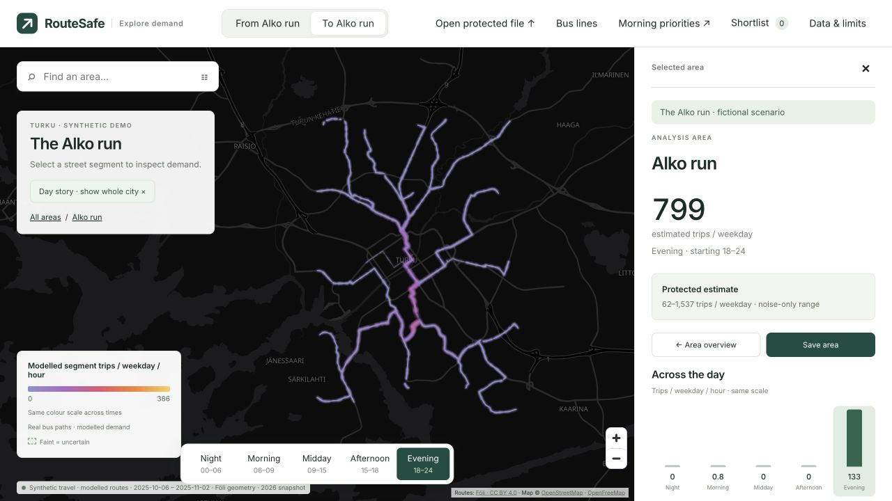

# Full fictional hackathon day — v2 evidence

The [scenario and criteria](../../planning/KUPITTAA_DAY_V2.md) and generator were frozen at `ff8fb0d` before generation and the single OpenDP publication. This is an independent invented DAY- population: 10,000 exaggerated fictional attendees, 2,000 background cards and 203,556 boarding observations. The two event weekdays, 30–31 October 2025, are illustrative. Names such as Alko run identify fictional coarse-area activities, not real customers, shop coordinates, opening hours or actual event turnout.

## Measured outcome

| Departure band | Target and direction | Raw inferred period trips | Protected period trips | Protected rank | Positive lower noise bound? |
|---|---|---:|---:|---:|---|
| 00–06 | From afterparty, G13 | 12,000 | 12,233 | 1 | No |
| 06–09 | To Kupittaa, G14 | 20,000 | 20,779 | 1 | Yes |
| 09–15 | To lunch, G12 | 20,000 | 20,548 | 1 | Yes |
| 15–18 | From Kupittaa, G14 | 20,000 | 19,408 | 1 | Yes |
| 18–24 | To Alko-run area, G08 | 16,000 | 15,984 | 1 | Yes |

The primary visual criterion passes for all five targets; the secondary criterion fails at night. The night view retains “Too uncertain to rely on.” Fine origin–destination pair WAPE is **52.8%**, exceeding the 20% target; contribution-cap loss is **5.6%**. Morning pair top-three overlap is 2/3. All results describe one deliberately constructed population and one draw. They are not repeated-population reliability evidence or validation of real travel demand.

Rates average over all 20 weekdays, including the two invented event days. Conservative noise-only bounds exclude contribution-cap, destination-inference and route-assignment errors. Destinations are inferred from boarding sequences. The simplified afterparty overnight closure is a scenario assumption. [Full evaluation](evaluation.json) retains failures alongside successes.

## Publication and privacy boundary

Manifest SHA-256: `0792b058dbcee3f9fcf1c703c2c06646ca34b340c2856f22321e9d19a5a6f09f`. [Receipt](release-receipt.json). The unchanged card-level epsilon-1 policy was published once under the independent fictional population's ledger, `private/kupittaa-day-v2-accounting/ledger.sqlite`. The workbench reuses that exact release. Earlier releases remain unchanged; no redraw or seed selection followed evaluation. Distinct namespaces alone would not justify separate accounting for overlapping real people.

Protection includes per-card whole-period contribution caps and OpenDP integer Laplace noise after aggregation. The unit is one card, not a person with multiple cards. OpenDP's measurement check does not prove the custom preprocessing argument. The release remains `pending_review`; local ledger enforcement does not coordinate separate machines or prevent a malicious operator. No production certification or universal resistance to inference is claimed.

The registered raw ZIP stays in the private workbench. The portable protected JSON embeds the nine verified release files and readable aggregate summaries. The planner validates and opens it locally, deriving values from the original files. Public bus paths are modelled assignments of protected area demand, not measured passenger paths, line occupancy or evidence that a particular number of extra buses is needed.

## Demo and verification

Use [the run instructions](../../web/README.md#latest-full-day-demo-kupittaa-day-v2). The large destination marker is removed. **Follow the day** explicitly changes the selected area/direction with each time band; manual selection returns to exploration. All bands share a fixed heat scale.

Keep the short ChatGPT demonstration, with actual responses in a fresh chat: aggregate patterns should remain useful; individual records are absent. A refusal to retrieve a commuter is an illustration, not a privacy test. Show the protection steps **Group journeys → Limit each card’s contribution → Add calibrated noise**. No IDs-removed comparison screen/file or external AI upload is part of this implementation.

Verification: 79 Python tests and 50 frontend tests passed; both builds and the 68-file public-boundary check passed. Backend testing exercised the v2 upload-to-share workflow and exact artifact reuse. Browser checks confirmed both pages, actual recipient preview, story-mode morning/evening/night selection, explicit direction changes and the retained night warning. The matching v2 protected JSON from the Downloads package was also verified and opened locally in the browser. Real-world utility, an independent privacy audit and the external ChatGPT response remain unverified.

## Two-file handoff

The local demo package now has `01-RAW.json` and `02-PROTECTED.json` at its top level. The raw JSON is 2,818,362 bytes and preserves all 203,556 original records in reversible per-card encoding; the protected JSON is 1,101,662 bytes and contains the unchanged release. Original CSVs and sanitization ZIP remain in Supporting files. Neither raw file is committed or copied to the public build.

The planner's **Open data file** accepts both. Raw mode computes inferred counts in the browser, labels them unprotected, and applies no contribution cap or noise. Protected import retains its existing contract validation. Browser QA opened both actual packaged files and switched from raw to protected successfully; morning Kupittaa values were 1,000 and 1,039 trips per weekday respectively. A map remount fixes the dataset-switch lifecycle failure found during this check. External ChatGPT attachment and response have not been exercised.

Verification for this extension: 52 frontend tests passed, including malformed raw records and protected-verifier rejection of raw data. The Python round-trip check reconstructs every raw source field and compares the full record multiset. The planner build and public-boundary check passed.

The operator now accepts that same raw JSON as well as its ZIP. It matches the lossless encoding against a snapshot of the registered input, then runs the normal validation/review/protection flow with unchanged publication/accounting rules. Altered records, duplicate JSON fields, stale revisions and already-protected uploads are rejected. The focused workflow/simulation suite passes 20 tests, including full raw round-trip preservation.

An isolated end-to-end run used the actual Downloads `01-RAW.json`, completed all six internal transitions through Share, and confirmed the portable result equals Downloads `02-PROTECTED.json`. It reused manifest `0792b058…`; no new noise or release was generated. The running operator was restarted with JSON support, and its upload control was verified in the browser.
