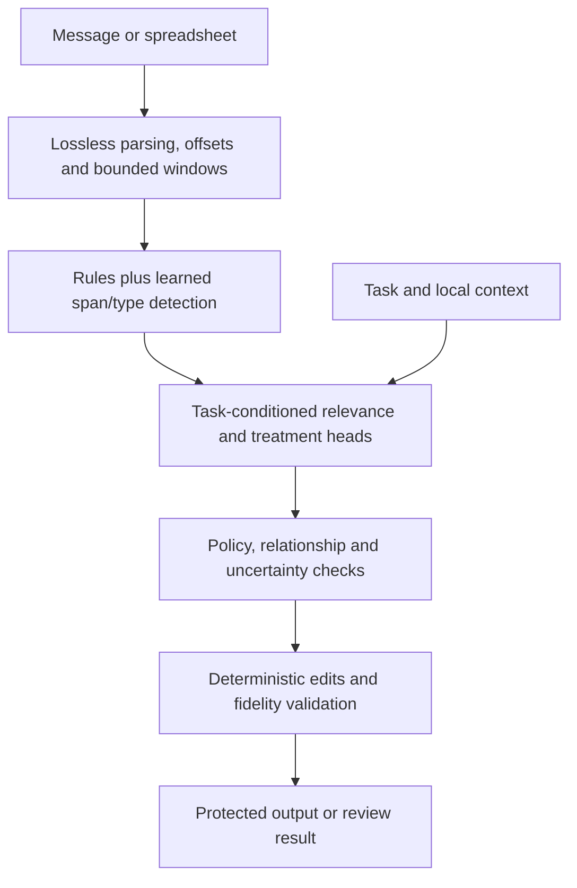

# Mask local privacy model build plan

Updated 7 November 2026. **Immediate priority: a readable, useful demo for approximately 100-word English messages within the user's under-19-hour deadline.** Quality and output readability take priority over speed and model size. The demo profile below supersedes the earlier ordering that deferred all UI integration until full release. The longer-term objective remains a small, evaluated local model and working message/spreadsheet adapters. Full release gates remain unchanged and unachieved. Most implementation, data management and evaluation happen on this computer; use available cloud compute for training as needed.

Language decision: **English first.** Finnish and Swedish require later datasets and separate validation; inherited multilingual rules do not establish multilingual model performance. English text can contain names and identifiers from other countries.

This document defines how to reach a ready artifact. No new model has been trained by writing this plan. A trained checkpoint alone is not completion: the final local package must pass the defined quality, coverage, fidelity and runtime checks on its supported scope.

**Build status, 7 November:** both local pilot models have now been trained, with a shared Python message/CSV/XLSX engine and executable checks. This is an engineering milestone, not a release: there is no independent audited validation/test set and both bundles remain review-only. See [runnable instructions](../mask/ml/privacy_v1/README.md) and [measured results/remaining failures](../evidence/privacy-v1/BUILD_REPORT.md). Later phases and release gates below remain outstanding.

**Non-model update:** output pipeline v2, stable `[PERSON_1]` substitution, conservative whole-section editing, bounded/atomic file handling and an optional intended-use field in the local preview are implemented. Blank intended use falls back to the source message as context, with a visible draft status. Trained weights remain unchanged. Use the [shared data-production prompt](../mask/ml/privacy_v1/annotation/TRAINING_DATA_PROMPT.md) now; its version-2 contract separates detector spans from action decisions. See the [pipeline report](../evidence/privacy-v1/pipeline-v2/REPORT.md) before claiming improved model accuracy. Review the first 40 accepted records from each producer before scaling to 200; assign independent development authors separately, then train and compare both tracks. No new training run has happened in this update.

## Immediate demo profile and latest user decisions

Target 50–150-word messages, with approximately 100 words as the primary demo workload. Check actual tokenizer capacity, including goal/context, rather than assuming a word count guarantees fit. Cover health, finances, work, customer support and ordinary personal messages; health can be a rehearsed scenario but is not the only supported goal. Assess unfamiliar inputs explicitly and show review/unsupported states when necessary. Do not promise competent handling of every topic from the current pilot.

Use familiar task patterns for the rehearsed demonstration if useful, including examples similar to training. Keep this demonstration material visibly separate from new combinations, new wording and independently authored robustness checks. Never count a rehearsed/training-adjacent example as held-out generalisation evidence. Already inspected difficult examples, including `complex-message-01`, are development/regression cases, not a final test.

### Transformation priority

1. Preserve task-essential facts, relationships and useful surrounding wording.
2. Within useful text, replace private identities with stable numbered labels such as `[PERSON_1]`. Preserve role words already present. Repeated mentions of one resolved entity use the same label; distinct resolved entities use distinct labels. Ambiguous identity links require review. Do not drop a person's mention merely because their name is private.
3. Remove a whole clause, paragraph or section when it is genuinely unnecessary for the goal and contains no required facts. Use one coherent DROP edit, including appropriate boundary spacing, rather than a row of placeholders. A sensitive category alone is not evidence that a whole paragraph is unnecessary.
4. Use other typed placeholders or supported faithful transformations when they better preserve useful structure. Stable labels are the default for names, not the only allowed method. ROLE-based deletion of a person's reference is not the demo priority.

The user's explicit correction is authoritative:

> My partner, Mateo Silva, recorded my blood pressure.

becomes:

> My partner, [PERSON_1], recorded my blood pressure.

Keep the relationship, the distinct person reference and the measurement context. Do not replace this with “My partner recorded my blood pressure” as the default name treatment.

Train and evaluate entity-level ALIAS/PLACEHOLDER decisions separately from clause/section-level KEEP/DROP decisions. Resolve overlapping actions once: a valid whole-section DROP supersedes edits inside that section, while a kept section still receives identifier protection. The present pilot only learned KEEP/ALIAS/PLACEHOLDER; usable section deletion requires new labels, executor tests and evaluation, not merely exposing an existing action name.

### Receiving-AI instruction

When provider integration is implemented, accompany protected text with this fixed instruction:

> Privacy note: Labels such as [PERSON_1] represent redacted references. You may use these labels verbatim in your reply. Do not guess or invent the hidden values.

Supply it as application-authored instruction metadata when the provider supports that; keep it distinct from user-supplied content. Send only protected content and this fixed note, never the local alias map or original values. Verify that the recipient retains the labels and answers the underlying question usefully. This is guidance, not a guarantee of provider behaviour. No provider send flow is implemented or executed by this planning update.

### Work order under the deadline

Fix word/entity boundaries and overlapping edits first. Author roughly 200 reviewed seed examples, then scale toward 3,000–6,000 diverse synthetic messages if annotation quality holds. Include readable expected outputs, exact edits, required facts, benign negatives, task swaps and whole-section DROP examples. Use available AI tokens for generation and independent annotation review; audit samples and disagreements without labelling agent agreement as human approval. Use cloud compute for bounded training comparisons.

Prioritise the encoder track for demo improvement based on the current failure analysis, while keeping the custom track trainable and comparing it on the same data. This is an implementation priority, not a final release selection. Reuse a minimal review UI once the text path improves. Treat small CSV examples as secondary. Defer quantisation, the 100 MiB target and subsecond optimisation from the demo critical path; retain them for the later full release. A polished demo must not be reported as having passed those release gates.

## 1. Product contract and meaning of ready

Deliver `Mask Local v1`: a compact model that recognises private information and chooses context-appropriate treatment, with deterministic execution and review/unsupported states. It accepts freeform messages, conversation context and basic CSV/XLSX tables. It works with networking disabled after installation/model download.

Inputs: English task/request, source message or file, optional relevant conversation history, and an explicit local policy. Outputs: protected text/file, edits with reasons/types, intentionally retained sensitive facts, model version, coverage and `ready | needs_review | unsupported` status. Original values and entity maps stay local and are excluded from shareable reports.

The contract is **remove unnecessary personal disclosure while preserving what the task needs**, not remove every sensitive fact. A health explanation may require health facts. The output must make their retention visible and must not label that content anonymous. If privacy and task necessity conflict, return review rather than silently inventing facts or discarding the question.

Version-one supported categories include person names, contact/address details, user/account IDs, supported national/payment/bank identifiers, credentials/secrets, identifying dates/locations/organisations, and contextual health/financial/employment/family information. Publish an exact taxonomy and supported identifier formats. A number pattern is not automatically PII, and unrecognised content is not automatically harmless. Unknown languages, undecodable content, incomplete scanning and ambiguous context do not produce a ready result.

## 2. Inspiration and two-track architecture experiment

The Token Company describes a small classifier that scores token importance and applies deterministic delete-only compression before an LLM call. Borrow the narrow prediction task, efficient inference and reproducible edits. Its service, performance claims and compression targets are not Mask's privacy guarantees. Privacy needs task relevance, identity detection and interaction checks in addition to importance scoring. [Company description](https://thetokencompany.com/about), [compression documentation](https://thetokencompany.com/docs/compression).

**Implement and evaluate both options before choosing the release architecture.** Track A develops our original custom-classifier approach; Track B tests whether pretrained language representations improve enough to justify their footprint. Neither is the predetermined winner. Both use the same input contracts, supported actions, rules/policy constraints and deterministic executor. Do not train a foundation model, require a remote LLM at inference, or start with unconstrained rewriting.

| Track | Representation and learned components | Purpose |
|---|---|---|
| A — custom Mask | Existing detector plus explicit character/word features, local sentence cues, span types, schema/row context, goal features and goal-by-data interactions; train our own relevance/treatment classifiers from scratch | Test whether a genuinely small task-specific system is sufficient |
| B — pretrained encoder | Compact encoder fine-tuned with span/type, relevance and treatment heads | Test whether learned language context reduces misses and mistaken treatment |

### Track A: our custom classifier

Start with regularised logistic/softmax heads over sparse character/word n-grams, identifier shapes, nearby cue words, detected categories, relations, goal terms and explicit interactions. Fit all learned vocabularies/statistics on training data only. Compare a small MLP only if validation errors justify it; include dense feature matrices and preprocessing assets in the size budget. This is an improved version of the original Mask architecture, not merely re-scoring the old institutional model.

Reuse rule candidates, but measure missed spans separately. Where detection is the bottleneck, add a lightweight token/span tagger trained from scratch over the same text/shape features and reconcile its candidates with rules. Do not expect a stronger action head to recover private information it never receives. Track A must not quietly depend on a pretrained encoder; any such hybrid would be a separately named later experiment.

### Track B: pretrained encoder challenger

Use `microsoft/MiniLM-L12-H384-uncased` as the initial challenger: an available English 33M-parameter, MIT-licensed encoder requiring task fine-tuning. Pin the checkpoint revision and tokenizer. It is a candidate, not the selected backbone. A smaller distilled student is optional only after this comparison identifies a real speed/size problem. [Model card](https://huggingface.co/microsoft/MiniLM-L12-H384-uncased).

LLMLingua-2 is a research example of teacher-labelled data used to train an encoder for token classification, not evidence that Track B is better for Mask or guarantees privacy. [Paper](https://aclanthology.org/2024.findings-acl.57/).



### Shared predictions and execution

- **Span/type head:** sequence tagging for identifying information; additional clause-level candidates for sensitive facts that are not simple named entities. Rules supply high-recall candidates for supported structured identifiers/secrets. Union and reconcile candidates; do not let a goal description erase a high-confidence identifier finding.
- **Relevance head:** for a span/clause and its task/context, classify `essential`, `unnecessary`, or `uncertain`. The same date or health fact must be judged differently across legitimate tasks.
- **Treatment head:** masked softmax over `KEEP`, `DROP`, `ALIAS`, `ROLE`, `GENERALISE`, `PLACEHOLDER`. Review is triggered by uncertainty or unmet preconditions, not a claim that the model has proved safety. Generalisation parameters come from a small supported registry.
- **Executor:** copy unchanged text exactly; replace only identified offsets. Stable local aliases distinguish entities without inventing realistic personal identities. Role labels require evidence in the source. Unsupported transformations fall back to a typed placeholder/review, not made-up ages, diagnoses, cities or dates.

For Track A, keep detection features goal-independent and provide goal/context interactions to the relevance/action classifiers. For Track B, use the shared encoder in a text-only detection pass and a task-conditioned action pass over detected windows. Both passes share weights; they are not two deployed encoders. Cache within a session and batch windows/cells. Only fuse passes later if detection invariance and performance are verified.

Use common source/context windows for the controlled comparison. Track B starts with a 512-token encoder limit, reserving space for task/history and overlapping source windows; Track A receives the same source content through its own features. Keep original character/cell offsets, including Unicode and line endings. Model-specific token counts are not comparable workload sizes: benchmark the same raw requests/files. Never silently truncate a message, cell, spreadsheet or history. If dependencies extend beyond retained context, request review. Test spans crossing every boundary.

Both tracks optimise supervised span/type, relevance and action targets with cross-entropy, masking missing labels and invalid actions. Track A may train its components separately; Track B can use `L = lambda_span * CE_span + lambda_relevance * CE_relevance + lambda_action * CE_action`. Tune weights and thresholds on validation data. Use the same hard negatives, class balancing protocol and task-swapped pairs. Optional teacher soft targets require provenance; an agent's self-rated confidence is not a calibrated probability.

During training expose the action head to realistic predicted-span errors, not only perfect gold spans. Evaluate both components and end-to-end output. Choose automatic handling thresholds by measured risk/coverage and calibrate on validation data; softmax concentration alone does not establish confidence on unsupported inputs.

### Fair comparison and architecture decision

Freeze one training/validation/test manifest, label version, action registry and shared executor. Give both tracks the same approved training examples and source information. Record model-specific preprocessing, pretrained data provenance where known, search configurations, seeds, compute and training time; pretraining is Track B's explicit advantage, not something to conceal. Run both pilot pipelines before committing the full labelling/training budget.

Evaluate three levels: (1) span/type detection, (2) relevance/treatment on identical gold or shared detected spans as a diagnostic, and (3) complete protected output from each actual detector. Diagnostic gold-span accuracy must never be presented as end-to-end privacy performance. Include rules-only and goal-agnostic ablations. Compare privacy/fidelity at matched automatic coverage as well as each calibrated release operating point.

Select architecture and thresholds on validation data only. Both must face the same release gates. Prefer the smaller/faster complete package when its privacy and utility are within predeclared acceptable quality margins; define those margins before the comparison, and do not interpret an inconclusive difference as proven equivalence. Otherwise choose the better supported quality result if it fits local budgets. If neither qualifies, improve the failed component and dataset; do not choose a winner by branding or relax gates after seeing results.

Before opening final test results, freeze one candidate from each track and record the validation-selected release candidate. Run both once for the final comparison. If the selected model fails, do not switch to the other on the same test and call that independent selection; fixes or a changed selection need new independent confirmation evidence. Retain both artifacts, complete metrics and a written selection rationale even when only one is deployed.

## 3. Local API and faithful transformations

Implement one reference Python package first, provisionally `mask/ml/privacy_v1/`, with a CLI and local inference API. Keep the existing TypeScript model and CSV application running as baselines. Browser inference is a later port unless a parity-tested browser runtime is required for the finished model; it is not the initial bottleneck.

Proposed API contracts (to implement, not current commands):

```python
protect_text(text, task, history=None, policy="consumer-v1")
protect_table(path, task, policy="consumer-v1")
# -> protected output, edits, retained_sensitive, coverage, status, model_version
```

Use explicit recipient/task policy; goals cannot override blocked credentials or direct-identifier rules. If a task needs a direct identity, use a local alias/placeholder or return review. Preserve task-critical numbers, units, negation, comparisons, dates/intervals, relations and uncertainty. Numeric generalisation is valid only when justified for that specific task. Never use the existing random age/date/location surrogates as factual privacy transformations.

Keep all entity maps local, scoped to a conversation/file. Name collision and repeated aliases need tests. A changed task invalidates previous choices. Check the complete transmitted context, since multiple individually innocuous details can identify someone together. Conservative relation/uniqueness checks are useful proxies, not proof of anonymity. No remote raw-message summariser or embedder is permitted in the inference path.

## 4. Messages and spreadsheet adapters

Freeform messages include short requests, pasted notes, emails, mixed prose/numbers, misspellings, formatted identifiers and multi-turn context. A missing/ambiguous task yields conservative protection plus a review state, not invented task intent. Persist no raw logs by default. Treat embedded instructions in source data as content rather than authority to change privacy policy.

**Basic spreadsheets means CSV and ordinary values-only XLSX**, including text/numeric/date cells and several sheets. Preserve table structure, headers and useful numerical values where permitted. Per-cell decisions include headers, column profiles, row context and relevant neighbouring cells. Profile columns for interpretation but scan every exported cell: sampling must not miss a rare identifier near the end. Do not assume all cells in one column contain the same type of information.

Concrete adapter requirements:

1. Parse locally with stable cell coordinates and types; enumerate every sheet and detect hidden rows/columns/sheets. Explicitly list which sheets are exported and scan all exported content.
2. Include headers and sheet names in the privacy pass. Handle identifiers in free-text cells and identifying combinations across fields/rows. Resolve high-risk combinations conservatively or flag them for review.
3. Batch bounded row/cell windows with schema context. Cache only when value, task, schema and relevant context match. Repeated values with different meanings must not inherit a cached action blindly.
4. Reconstruct a **new values-only workbook** or CSV. Never copy the original XLSX archive and modify only visible cells. Omit source comments, revision/property metadata, links, embedded objects and hidden content unless explicitly selected and scanned. Use a neutral output filename and protected sheet labels.
5. Preserve cell types, nulls, ordering and alias consistency. Ensure substituted text cannot become an executable spreadsheet formula; preserve literal string semantics on export.
6. In v1 reject password-protected files, macros, formulas/external references and complex embedded objects instead of silently evaluating or forwarding them. Images/OCR, merged report layouts and legacy binary XLS are unsupported. Do not claim arbitrary workbook round-trip fidelity.
7. Enforce documented resource limits before processing; initially target up to 10,000 nonempty cells across supported sheets, with bounded cell length and total tokens. Larger files return an explicit limit/review state, not a partially sanitised ready file. Increase limits only after streaming/coverage validation.

Outputs are fresh files plus a coverage manifest showing all exported sheets/cells were processed. The model does not need to understand Excel formatting; adapters supply structure and preserve the data contract.

## 5. Data programme and independent evaluation

Existing 882 agent labels concern institutional field/span-class recipes; preserve them and use only compatible examples as auxiliary training with explicit provenance. Do not mix legacy test material into a new test. Existing lexicons were built with challenge data visible, so those sources are development/regression material for inherited detection, not fresh blind evidence.

### Pilot and scale-up

First author a 300–500-example development pilot covering messages and cell/row windows. Confirm annotation consistency, the action vocabulary and a complete tiny training/export/inference cycle before expensive labelling. This pilot proves engineering, not reliability.

Then target an initial 10,000–30,000 training windows drawn from thousands of independent synthetic source families, with messages, conversation turns and spreadsheet cells represented. These are planning quantities, not a guarantee that the model will generalise. Expand by measured error modes rather than generating endless paraphrases. Include benign text, public entities, non-personal numbers, unfamiliar names, rare embedded identifiers, obfuscations, long inputs and both relevant/irrelevant sensitive facts.

Create separately authored validation and final-test families. Budget at least 400 validation and 600 final-test family-level cases across messages and spreadsheets, with several held-out workbook schemas and conversation patterns. Derive windows only after family splits. Keep every shared persona, source, template, workbook, conversation and paraphrase in one split; use near-duplicate checks. Include an out-of-template challenge slice and report it separately. Freeze the test and do not use it for prompt design, active learning, calibration or quantisation decisions.

### Labels and audit

Agents may generate synthetic source cases and propose span/type, relevance, action and approved-output labels. Keep those tasks distinct. A separate reviewer checks offsets, task necessity, factual invariants and acceptable alternatives. Human-audit all disagreements and stratified agreements; adjudicate the release validation/test cases independently of the training teacher. If audit capacity is insufficient, reduce the claimed evaluation scope rather than call unreviewed agent labels gold.

Each record stores source/split IDs, task, source offsets/cell coordinates, sensitivity types, relevance, action/parameters, acceptable alternatives, required-fact checklist, link/entity IDs, approved output, annotator/reviewer versions and status. Synthetic generators provide known planted values, but independently check extra incidental sensitive content. Do not store hidden evaluation labels in model features.

Important counterfactuals: same message with a different task; same task with different private facts; same category but different relevance in one input; benign numbers next to IDs; different people sharing a first name; a spreadsheet's last row containing the only secret; fragments split across turns/cells; relevant health facts next to irrelevant contact details.

Use public/licensed English corpora only after checking annotation, licence and provenance. Do not scrape actual private conversations for training. Cloud labelling/training uses synthetic or explicitly authorised data.

## 6. Training and local packaging

1. Freeze common schema, pilot, source splits, local environment and baseline measurements. Pin Track A's feature definition and Track B's checkpoint/tokenizer. Verify exact offsets and matching executor outputs before full runs.
2. Train Track A's custom classifiers locally, initially on CPU. Separately run Track B's detection/action fine-tuning smoke test. Preserve rules in both. Both tracks must produce genuine learned outputs through the shared text/file API before scaling up.
3. Scale both on the same reviewed data. Track A can remain local; Track B may use a single available cloud GPU. A 16–24 GB GPU is a starting configuration to test, not an assumed requirement. Size batches by smoke runs, use resumable checkpoints, and keep audit/local acceptance on this computer.
4. Predeclare bounded search budgets for each track. Track A searches regularisation, n-gram/interaction features and optional small hidden size; Track B searches learning rate, fine-tuning/early stopping and head-loss weights. Record configurations, costs and several seeds for finalists. Do not compare one tuned track with an intentionally weak default of the other.
5. Validate local packaging for both. Track A may use a compact weights/feature artifact or ONNX; Track B exports float ONNX and tests INT8. Verify prediction/edit parity against each training reference. Quantisation can change accuracy: rerun privacy/action/fidelity checks on **validation** data and retain float/mixed precision if needed. [ONNX Runtime guidance](https://onnxruntime.ai/docs/performance/model-optimizations/quantization.html).
6. Calibrate each deployed runtime and operating point; compare on validation under the common selection rule. Freeze both finalists and the selected release candidate, then run the independent final comparison once. Any test-informed fixes/selection changes require new confirmation data.
7. Package the selected weights, feature assets/tokenizer, config, policy/recipe registry, rules, offsets, adapters, checksums, dependency lock, licences, model card and release report. Include the A/B report and selection rationale. Verify offline inference in a clean local environment. Ship no teacher/API dependency.

Local ARM64 architecture is confirmed. CPU model and memory could not be read under the current sandbox; record them during phase 0 and benchmark on the actual machine. Do not imply an M-series model or RAM amount from architecture alone.

## 7. Release criteria

These are **proposed engineering acceptance gates**, not current measurements or organiser requirements. Freeze definitions/denominators before full training. Require both quality and nontrivial automatic coverage so “review everything” cannot pass. Report results separately for messages, spreadsheet content, schema novelty and critical categories, plus uncertainty intervals grouped by source family.

| Area | Initial gate for the declared English v1 scope |
|---|---|
| Required-removal identifiers/secrets | At least 99.5% end-to-end removal recall on independent labelled spans; at least 99% for each adequately sampled critical category; no identifier/secret escape in the separate mandatory canary suite |
| Contextual unnecessary disclosure | At least 97% removal/treatment recall on annotated nonessential sensitive facts; report actual residual facts and attack outcomes, not just detected spans |
| Required meaning | At least 99% required-fact retention; zero unsupported changes to protected numbers, units, negation, chronology or relations in the critical-fidelity suite |
| Over-removal | At most 1% benign non-sensitive spans altered unnecessarily on the clean-negative set; report how much source text is changed |
| Context dependence | At least 95% acceptable treatment on held-out task-swapped pairs, while direct-ID/secret invariants remain unchanged |
| Automatic coverage | At least 80% of supported held-out requests complete without review, reported separately by input type; unresolved outputs are not credited as successful protected exports |
| Downstream utility | At least 95% of the original-prompt task score on a predeclared audited rubric, and better retention than fixed masking at comparable disclosure/coverage; independent reference checks, not raw-answer imitation alone |
| Spreadsheet integrity | 100% of exported cells/sheets accounted for; no unscanned metadata copied; expected types/structure preserved; unsupported features and processing limits fail explicitly |
| Local boundary | Model/adapters run with network disabled; no raw-value logs/telemetry; corruption, missing assets or cancelled scans cannot produce ready output |
| Size | Deployed model/tokenizer/rule assets target at most 100 MiB, runtime package reported separately; include every encoder/auxiliary model rather than quoting only head size |
| Latency/memory | Initial targets: warm p95 at most 500 ms for a 256-token request, at most 2 s for 1,024 tokens, cold load at most 5 s, peak process RSS at most 1 GiB on the named local machine; measure full detection/action/edit path |
| Spreadsheet throughput | Initial target at most 60 s for 10,000 supported short cells (median at most 20 tokens), including parsing/scanning/reconstruction; separately report total tokens and long-cell behaviour |

Use at least 1,000 required-removal test spans across at least 200 source families, with enough examples per claimed category. Report 95% intervals and sample sizes; do not advertise a 99.5% population guarantee from a point estimate. Categories with inadequate coverage remain experimental. A fixed canary suite does not replace a broad held-out test.

Measure raw model predictions and final automatic outputs separately; report risk/coverage curves and attempted leaks in review cases. Evaluate all required-removal information, including misses by the detector. Ground truth cannot come solely from the detector being tested. Include full-history and cross-field inference attempts with fixed attacker assumptions; report coverage and failures even if span metrics pass.

Performance budgets are targets to verify in phase 0 and freeze before optimisation. If hardware cannot meet them, agree a new versioned budget or optimise; never silently redefine a slow result as passing. No model is marked ready merely because time is short or training finished.

## 8. Execution sequence on this computer

| Phase | Work and deliverable | Exit condition |
|---|---|---|
| 0. Contracts and baselines | Define common policy/categories, Track A features, Track B checkpoint, adapters, grouped splits, comparison rule and acceptance file; measure local hardware/runtime | Frozen task/metrics and runnable rules/legacy baseline |
| 1. Two pilot loops | Train/export custom A and encoder B on the same pilot; share deterministic actions and offline protect_text | Both produce real learned outputs with correct offsets/edits |
| 2. Shared text/table engine | CSV and values-only XLSX adapters, all-cell coverage, history/entity maps and integrity tests | Same model serves both modes; rare/end-of-file and unsupported-feature tests pass |
| 3. Data and training | One audited grouped dataset; train both tracks with documented search budgets; cloud for B as useful | A/B models with genuine validation results and recorded costs |
| 4. Error reduction | Diagnose detector versus action failures, apply shared data improvements, run ablations/calibration | Fair quality/coverage/fidelity comparison without opening final test |
| 5. Optimisation and selection | Runtime parity, applicable quantisation, batching and local footprint checks for both | Freeze both finalists and validation-selected release candidate |
| 6. Independent release | Final A/B evaluation, selection rationale, clean offline run and model card | Selected model passes every gate; otherwise documented failure/new iteration |

Work primarily in one checkout with one active owner per file. Cloud jobs consume versioned manifests/checkpoints and return artifacts; keep the local repo as the source of truth. No dependency on three teammates/computers. Do not provision additional paid instances without a concrete need; readily available compute removes a training bottleneck, not a label-quality bottleneck.

Expected new artifacts (paths are proposed, not existing commands):

```text
mask/ml/privacy_v1/
  configs/                  custom_a, encoder_b, comparison and release gates
  data/                     manifests and provenance; raw data ignored
  annotation/               schemas, generation/review prompts and audits
  adapters/                 text, CSV and XLSX
  models/                   custom feature classifier A and encoder/head B
  train.py  evaluate.py      reproducible training and offline assessment
  export.py  protect.py      deployment export and local inference CLI
  tests/                    fidelity, offsets, coverage, policy and IO checks
mask/models/privacy-v1/      versioned local release bundle
evidence/privacy-v1/         A/B metrics, selection rationale, model card and limitations
```

At completion provide the selected local model bundle, executable API/CLI, example message and spreadsheet outputs, reproducible training/export for both tracks, audited A/B report, selection rationale, ablations and hardware profile. Trying both is required; deploying both is not. A plan, a training notebook or a UI that calls a cloud model is not this deliverable.

## 9. Reuse and defer

Reuse the current detection rules, public synthetic source material for development, keyed alias ideas, contract/versioning discipline, exact-output checks and benchmark reporting patterns. Preserve legacy models, splits and CS reports; a new training task requires new action labels and evidence. Keep known USERNAME errors as regression examples and fix their general cause.

Defer UI polish, direct ChatGPT website integration, additional institutional scenarios, arbitrary PDF/OCR/formulas, Finnish/Swedish release claims and training a generative language model. `pets-eval` remains useful for compatible regression slices, but table k-anonymity and composite scores do not establish contextual prompt privacy.

This is the authoritative current plan. Superseded pivot and institutional build plans were removed from the active tree; their history remains in Git. Both the local message preview and the existing table-review UI remain available for the demo. Continue implementation from the current status and requirements above.
