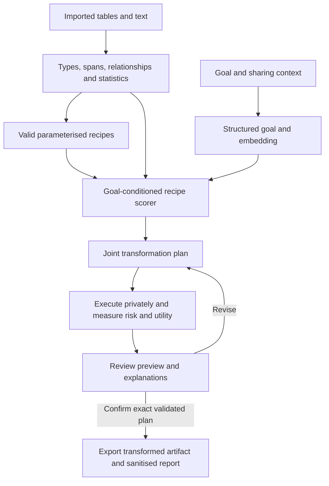

# Mask architecture and build plan

Status: proposed, 7 November 2026. This replaces the previous product direction. Only the challenge materials and generic detector baseline are currently available. The Mask application and learned selector are unimplemented.

The [implementation handoff](CLAUDE_BUILD_BRIEF.md) adds the product vision, white minimalist two-pane interface, parallel UX/functionality workstreams, three-computer/cloud coordination, and agent-assisted annotation protocol. Read it alongside this technical plan.

## Product and first scope

Mask accepts an analytical goal and mixed structured/text data, proposes how to protect it, previews the exact changes, and exports an approved transformed dataset with a sanitised decision report.

The primary learned task is **goal-conditioned protection-recipe selection**. Keep and suppress remain actions where appropriate, alongside tokenisation, redaction, generalisation and aggregation.

Proposed first demonstration: synthetic customer-service tables, with external complaint analysis and internal intent-model training as two reviewed purposes. Specify each recipient, threat assumptions and utility tasks using the supplied scenarios. Mixed content within supported inputs is in scope; arbitrary-domain reliability is not established. Additional domains need adapters, recipes and evaluators.

## Architecture

### Data and goal representation

Start with CSV tables including text columns. Preserve types, nulls, internal row identity and relationships. Unsupported inputs or unresolved semantics receive explicit unsupported/review states.

Extend the retained rules with a span detector. An LLM may assist with ambiguous schema interpretation, but dataset text is data, never instructions. Keep raw values and previews private; a remote LLM receives the user's goal and approved schema summaries by default. Raw-data processing needs an explicit supported arrangement.

Normalise the goal into a visible editable record: task, required measures, grouping variables, resolution, necessary joins, recipient and output form. Embed the task description while retaining constraints and recipient explicitly. Do not infer permission to release from goal wording. Map supported goals to executable utility evaluators; an unmeasured goal gets a tentative proposal, not a validated utility claim.

Represent semantic categories, uncertainty, precision, rarity, group sizes and linkage relationships. Categories alone cannot describe combined risk. Use appropriate decision units:

- Field or linked-field group for consistent structured transformations.
- Text span for redaction while retaining useful surrounding content.
- Table/query for aggregation or differential privacy.
- Row subsets only when required by the goal; assess resulting selection bias.

### Candidate recipe registry

Each recipe defines its ID, supported types, scope, parameters, preconditions, executor, relationship effects and evaluation requirements. Generate a bounded set.

| Scope | Recipe example | Required context |
|---|---|---|
| Linked identifiers | Keyed tokenisation | Consistent key/scope where joins are needed; mapping remains private |
| Text span | Typed placeholder redaction | Correct offsets and retained surrounding text |
| Date/time | Generalise to week/month | Calendar, timezone and required resolution |
| Number | Bin into approved ranges | Boundaries and outlier handling |
| Location | Generalise to region | Trusted mapping and unknown-location handling |
| Field/span/record | Suppress | Utility and missingness effects |
| Permitted content | Keep | Scenario-specific validity |
| Table/query, later stage | Bound contributions, aggregate, add calibrated noise | Privacy unit, bounds, budget and repeated-release accounting |

Tokenisation and partial masking do not by themselves establish anonymity. Describe outputs as protected/transformed with stated residual risk. Differential privacy is a query/dataset mechanism, not an arbitrary per-cell noise choice.

### Method selector and loss

For decision unit i and candidate recipe m, score the data features h_i, goal embedding g, sharing context c, relationship context r_i and recipe features v_m:

`z_i,m = f_theta(h_i, g, c, r_i, v_m)`

Mask invalid candidates before softmax:

`p_i,m = exp(z_i,m / T) / sum(exp(z_i,k / T) for k in valid_candidates_i)`

Softmax chooses among alternatives at one decision point. When operations must be combined, score complete bounded recipes (for example contribution bounding + aggregation + noise) or make staged choices and re-evaluate the resulting plan. Do not treat necessary sequential operations as mutually exclusive labels.

Start with regularised multinomial logistic regression with goal/data interactions, or a small MLP over frozen embeddings. Use candidate-specific weights or interactions: adding the same goal-dependent constant to every candidate logit would cancel in softmax and cannot change the ranking.

For a single reviewed best recipe, train with categorical cross-entropy: `L_i = -log(p_i,target)`. PyTorch `CrossEntropyLoss` takes raw logits, not softmaxed probabilities. When several recipes are comparably suitable, retain the acceptable set or use justified soft targets: `L_i = -sum(q_i,m * log(p_i,m))`. Do not invent one uniquely correct target. Binary cross-entropy remains appropriate for separate binary attack-outcome or multilabel detection heads.

If no candidate is valid, abstain; never normalise an all-masked vector. A confident preference among poor candidates is not evidence of suitability. Use unsupported-input checks, uncertainty handling and complete-output validation. Fit calibration only on validation data; display model preference rather than probability of anonymity. Propose deterministically rather than sampling export methods.

### Combined risk and plan selection

Check the complete proposed output for uniqueness, linkage, sensitive-attribute inference and required joins. Individually suitable field choices may fail together.

A logistic risk estimator can use interaction/statistical features and binary targets for specified attack outcomes. Define the attacker knowledge, success event and unit of evaluation. It is a proxy for tested attacks, not every possible disclosure risk. Prefer direct attack evaluation on final outputs where feasible.

Search a bounded set of complete plans proposed by the selector, retaining useful analysis while satisfying predeclared scenario constraints. Record empirical risk thresholds, utility losses and unresolved assumptions. Independent per-field argmax choices are not guaranteed to form a valid plan.

For real private data, adaptive selection and published diagnostics can also disclose information. Any differential-privacy claim must account for private-data-dependent plan selection and repeated releases. Initial experiments use synthetic data.

## Required adversarial benchmark integration

Implementation requirement added during the active Claude build: implement a benchmark adapter around the supplied `pets-eval` toolkit. This section specifies work and acceptance criteria, not completed Mask measurements. The package contains attacker background data, executable attacks, utility tasks and reference protection baselines; it is not one pretrained adversary model.

Owning sources under `TRUSTED_SinceAI2026_FINAL/TRUSTED_PETS_PROVING_GROUND_2026/`:

- [Threat model](../TRUSTED_SinceAI2026_FINAL/TRUSTED_PETS_PROVING_GROUND_2026/docs/THREAT_MODEL.md)
- [Attack specifications](../TRUSTED_SinceAI2026_FINAL/TRUSTED_PETS_PROVING_GROUND_2026/metadata/attack_specs.json)
- [Evaluation contract](../TRUSTED_SinceAI2026_FINAL/TRUSTED_PETS_PROVING_GROUND_2026/docs/EVALUATION.md)
- [Reference baselines](../TRUSTED_SinceAI2026_FINAL/TRUSTED_PETS_PROVING_GROUND_2026/docs/BENCHMARK.md)
- [Scorecard implementation](../TRUSTED_SinceAI2026_FINAL/TRUSTED_PETS_PROVING_GROUND_2026/toolkit/pets_eval/scorecard.py)

### Adapter and feedback loop

1. Accept a supported source dataset, scenario, frozen split assignment and versioned complete transformation plan.
2. Execute the plan and write a private benchmark staging representation. Preserve the toolkit's expected table/column names and supported generalised-value formats, or document and validate an adapter. Preserve private row mappings after filtering, sorting or tokenisation; never restore original identifiers into the shareable artifact just to make scoring work.
3. Run relevant linkage/inference attacks, residual-identifier and text-leakage checks, and the scenario's utility tasks. Keep original and protected runs comparable. Record sampling limits and denominators; do not silently substitute a partial scan for a full benchmark.
4. Return per-test coverage and status (`evaluated`, `not_applicable`, `unsupported`, `failed`), metrics, assumptions, toolkit/configuration versions, input/output/plan hashes and private artifact references. Missing, skipped or failed tests must not become zero-risk observations. Toolkit scores are self-assessment evidence, not the official judging rubric or a probability of anonymity.
5. On development data, compare several executed candidate plans. Select plans with the best relevant utility among those satisfying predeclared constraints; record acceptable alternatives. If none qualify, retain the failure/abstention rather than inventing a successful label.
6. Use reviewed results as supervision for the softmax selector. This is offline target generation followed by cross-entropy training; no backpropagation through attack code or adversarial neural-network training is required. An optional learned risk proxy must be validated separately.

Agent-generated labels propose candidates; measured outcomes and review determine acceptance. A complete-plan score does not automatically assign causal credit to each field recipe. Retain the surrounding plan in training examples and evaluate controlled substitutions where field-level targets are needed.

### First customer-service evaluation

The supplied `leaked_customer_list` linkage specification targets the `customers` table through name, email and city, with `accessibility_needs` as the sensitive attribute. It does not automatically evaluate every attack on conversation text or every cross-table inference. Pair it with separate annotated-span leakage checks on transcripts/notes and scenario-relevant utility tasks such as intent classification, complaint mix and resolution rate.

Display uncovered transcript/cross-table threats explicitly. Implement additional attacks when needed for a claim, reporting those separately from the unchanged supplied benchmark. If tables are withheld or replaced by aggregates, explain which row-level attacks become inapplicable and what evaluates the released representation instead.

### Evaluation isolation and final validation

Keep benchmark truth, attacker knowledge and scoring rowmaps in offline/private evaluation. Ground truth verifies attack success; it must not be an inference feature. The final export excludes these files. Without rowmaps or original IDs the toolkit may treat a table as synthetic, so validate representation classification instead of accepting misleading scores.

Split before target generation. Development attacks used to choose labels are no longer independent final evidence on those cases. Freeze held-out sources/goals, avoid repeated test-driven tuning, and use the documented optional organiser-held stronger attackers/hidden labels when available. Do not claim those checks occurred until results exist. Reference baselines that use the catalog have privileged type labels: distinguish transformation-only comparisons from end-to-end detection performance.

For arbitrary user uploads, ground truth and matching attacker data generally do not exist. Mark benchmark-derived metrics unavailable where necessary, and distinguish heuristic/proxy diagnostics from measured attack success. Do not invent ground-truth measurements in the UI. Any cloud benchmark job uses approved synthetic material and follows the same split/feature isolation.

### Integration ownership and acceptance

The pipeline owner implements the adapter, staging/rowmap handling and export isolation. The ML owner consumes versioned development results for labels and owns held-out comparison. The UI owner displays coverage, metric definitions, measured results and uncertainty separately from method preference.

Completion requires one fresh supported synthetic input with multiple genuinely executed candidate plans, reproducible privacy and utility reports, reviewed training targets, and a frozen held-out comparison. Test a retained-identifier positive control, a deliberately destructive transformation to expose utility loss, and an unsupported/failed attack to verify honest coverage reporting. Verify that changing a plan invalidates its old evaluation and that the public download contains no private benchmark material.

## Training and evaluation protocol

1. Define scenarios, recipes, threats, utility metrics and selection criteria before tuning. Detection labels identify content; they do not label the best method.
2. Split sources before generating variants. Keep people, conversations and all derived transformations together across splits; people recur across domains. Also hold out schemas/domains for field-classifier generalisation. Millions of rows do not provide millions of independent field labels.
3. Execute candidate complete plans on development data. Measure attack outcomes and task utility, then choose recipes using reviewed criteria. Store parameters, acceptable alternatives, provenance and scenario IDs.
4. Train the selector on these decisions. Evaluator-generated labels are surrogate targets under a stated objective. LLM suggestions require review and cannot serve as independent test truth.
5. Freeze the model and evaluate held-out sources/goals. Fit preprocessing and calibration without test data. Compare fixed policies, a goal-agnostic selector and stronger suppression. Test whether the goal improves useful choices at comparable risk.
6. Report per-type detection recall, acceptable-method agreement, calibration, abstention/coverage, constraint violations, actual leakage/linkage and before/after utility. Method accuracy alone is insufficient. Include failures.
7. Use the supplied unlabelled HR file for qualitative checks unless independently scored. It was inspected during prior scanner development. Preserve customer-service organiser-held labels and the official split; missing hidden annotations are not negative examples.

Truth, attacker inputs and private evaluation mappings never become hidden production features or exported content. Prior application results and supplied baseline scores are not Mask results.

## Minimal UI and developer panel

Main screen: goal text panel beside import/data preview. Then show the proposed transformed preview with labelled highlights: keep, tokenise, generalise, redact, suppress, needs review. Use text/icons as well as colour. Filter and sort by method, type, uncertainty, combined-risk group or review status. Keep stable source-row identities internally so sorting does not change transformation mapping.

Selecting a change shows detected type/evidence, goal relevance, recipe/parameters, alternatives and unresolved issues. Explanations come from the executed decision trace rather than post-hoc model guesses. Keep detection confidence, method preference and measured attack risk separate.

The private developer panel shows versions, candidate masks, distributions, calibration status, joint-risk checks, utility measurements and tunable thresholds/parameters. Original redacted spans are visible only in this private context.

Goal, input or parameter changes invalidate confirmation and rerun affected checks. Failed hard constraints require a valid revised plan or block export. Bind confirmation to the input hash, goal/context, plan version and output hash; export the exact reviewed artifact without stochastic regeneration.

Export transformed data and a sanitised report. Exclude original snippets, token maps, secrets, scoring rowmaps and private logs. Public diagnostics need their own disclosure assessment. User confirmation is approval of the artifact, not evidence of anonymity.

## Build sequence

| Stage | Deliverable | Completion evidence |
|---|---|---|
| 1. Specification | Two scenario records, recipe registry, metrics and split protocol | Reviewable scope and target-generation criteria |
| 2. Executable baseline | Import, detection, deterministic transforms, private preview/export | New supported synthetic inputs work; offsets, types and joins verified |
| 3. Training examples | Evaluated candidate plans and reviewed targets | Provenance, isolated splits and acceptable alternatives recorded |
| 4. Learned selector | Goal-conditioned softmax model with abstention | Held-out baseline comparison, independent privacy/utility results |
| 5. Joint validation | Complete-plan checks and bounded revision | Combination risks and incompatible recipes caught |
| 6. Demo | Minimal UI, developer panel, confirmed export | Actual before/after artifact, measured retained task utility and limitations |

Build actual executors before training so labels refer to actions that run. Demonstrate one coherent mixed-data workflow before extending domains.

## Sources and reset record

- [Challenge materials](../MATERIALS.md)
- [PyTorch cross-entropy](https://docs.pytorch.org/docs/stable/generated/torch.nn.CrossEntropyLoss.html)
- [Probability calibration](https://scikit-learn.org/stable/modules/calibration.html)
- [Interaction features](https://scikit-learn.org/stable/modules/generated/sklearn.preprocessing.PolynomialFeatures.html)

The transport frontend, publisher, maps, simulations, releases, application tests, evidence, submission drafts and previous planning documents were removed from the active project on 7 November 2026. Git commit `23eedc29d6f2a3cd945cac2a4307e91e6427af77` retains the prior tracked state. Local runtime files and a copy of retired content were moved to `/private/tmp/mask-retired-bfz9ordp`, a temporary recovery location.

The supplied challenge package and generic scanner remain. Generic regression checks replace transport-specific scanner fixtures. No Mask model has been trained or Mask application built during this reset.
